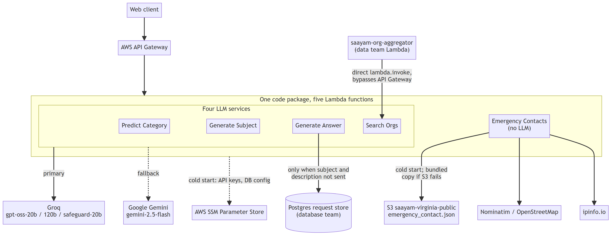
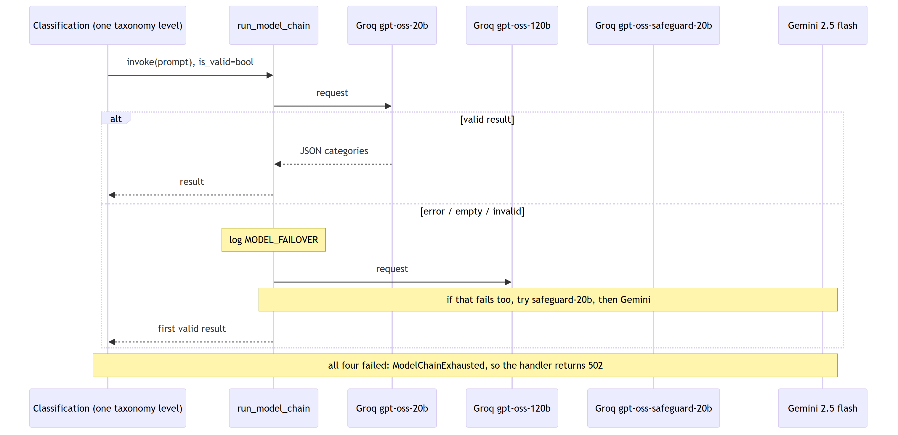
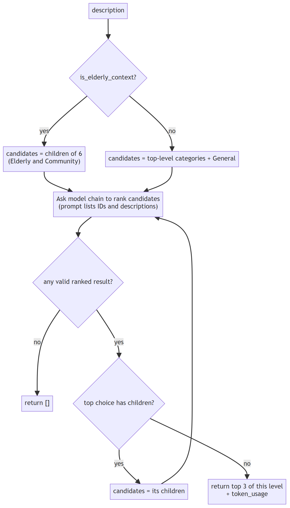
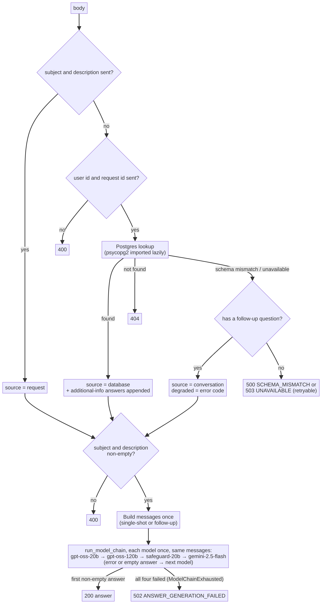
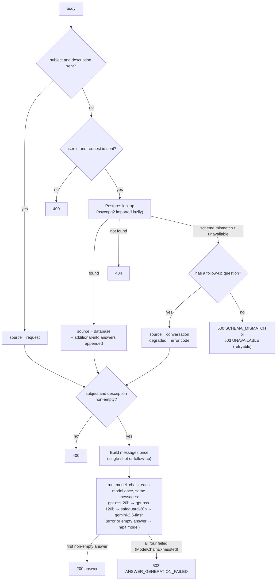
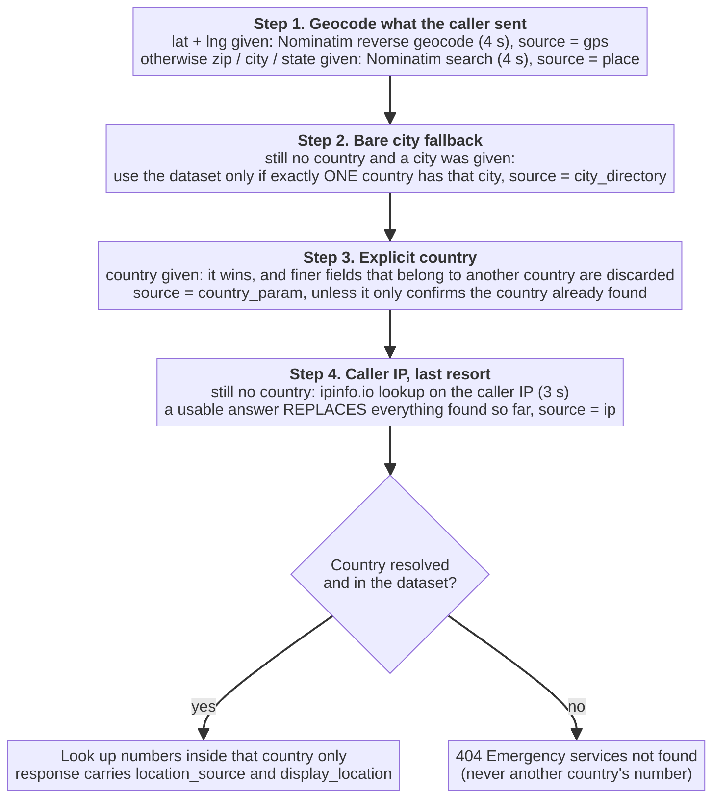
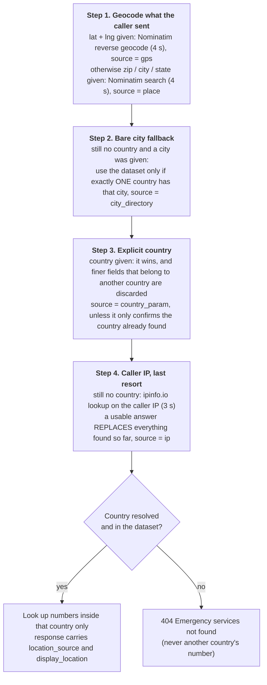
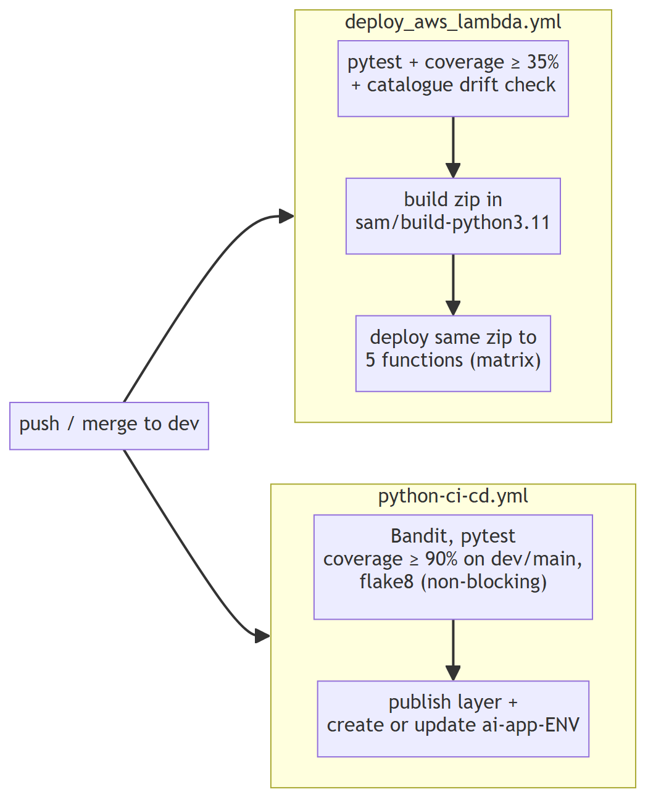

Saayam GenAI Architecture

| **Item** | **Detail** |
| --- | --- |
| **Repository** | [saayam-for-all/ai](https://github.com/saayam-for-all/ai) |
| **Verified against** | dev at commit [b0f99c1](https://github.com/saayam-for-all/ai/commit/b0f99c16fa64d3df66c76c404ef2813b354a064f), the merge of [#229](https://github.com/saayam-for-all/ai/pull/229) on 2026-11-11. Earlier revisions were verified against [271a402](https://github.com/saayam-for-all/ai/commit/271a40216cd3469784bb462536cfc4d05ff42bd4) (2026-10-16) and [002826f](https://github.com/saayam-for-all/ai/commit/002826fd0f4f914bd054ab9f658c49318134d2de) (2026-10-08); §2 lists what changed in between |
| **Document version** | v4, revised for dev b0f99c1. It supersedes the v3 draft attached to [issue #153](https://github.com/saayam-for-all/ai/issues/153) |
| **Tracking issue** | [#153 Documentation: GenAI Architecture](https://github.com/saayam-for-all/ai/issues/153) |
| **Audience** | GenAI contributors, the webapp team that calls these APIs, the data team that calls Search Orgs directly, and reviewers |

# How to read this document

Every factual statement carries a tag that says how it is known. Code links are pinned to commit b0f99c1, so the line numbers stay correct even after the code moves on.

| **Tag** | **Meaning** |
| --- | --- |
| **[code]** | Read in the source at b0f99c1. The link opens the exact lines. |
| **[ran]** | Reproduced by running the code or the test suite against b0f99c1. The command is given. |
| **[doc]** | Stated in a document already in the repository (linked). |
| **[reported]** | Reported by a team member in issue #153 from the AWS console or the API Gateway export. **Not re-verified here**, because it needs AWS access. |
| **[open]** | Unconfirmed. Listed in §15 Open questions with what would settle it. |

If you only have five minutes, read §1, §9 and §14.

## Contents

1. The system on one page

2. What changed since v3

3. Deployment and routing

4. The LLM layer

5. Services in detail

6. Prompts and guardrails

7. The category taxonomy

8. Data, privacy and security

9. Error contract

10. Observability, cost and latency

11. Testing and CI/CD

12. Internationalisation

13. How the architecture got here

14. Known issues and risk register

15. Open questions

16. Appendix: how to re-verify this document

# 1. The system on one page

The GenAI backend is one Python code package deployed as five AWS Lambda functions behind AWS API Gateway. Four of the five call a large language model (LLM). The fifth, Emergency Contacts, deliberately does not.

| **Service** | **What it does for the user** | **Calls an LLM?** | **API Gateway integration** | **Called by** |
| --- | --- | --- | --- | --- |
| **Predict Category** | Picks the help category for a request description | Yes, 4-model fallback chain | Non-proxy | Web client |
| **Generate Subject** | Writes a subject line of at most 70 characters | Yes, Groq → Gemini | Non-proxy | Web client |
| **Generate Answer** | Answers the "More Information" chat, optionally reading the request from Postgres | Yes, 4-model fallback chain | Non-proxy | Web client; data team's aggregator (single-shot) |
| **Search Orgs** ("More Organizations") | Suggests 6 organizations (3 nonprofit, 3 for-profit) | Yes, Groq → Gemini | Non-proxy | Web client, **and** the data team's saayam-org-aggregator by direct lambda.invoke |
| **Emergency Contacts** | Returns dialable emergency numbers for the user's country | **No**, deterministic lookup | **Proxy** | Web client |

Sources: handler list [code] [lambda_function.py:199-554](https://github.com/saayam-for-all/ai/blob/b0f99c16fa64d3df66c76c404ef2813b354a064f/lambda_function.py#L199-L554); integration types [code] [lambda_function.py:159-192](https://github.com/saayam-for-all/ai/blob/b0f99c16fa64d3df66c76c404ef2813b354a064f/lambda_function.py#L159-L192); org aggregator caller [code] [utils/search_orgs.py:1-13](https://github.com/saayam-for-all/ai/blob/b0f99c16fa64d3df66c76c404ef2813b354a064f/utils/search_orgs.py#L1-L13).



*Figure 1*

**Five facts to keep in mind while reading the rest:**

1. **Only Emergency Contacts returns real HTTP status codes.** The other four always return HTTP 200, and their status lives inside the response body (§3.4).

2. **There are two fallback mechanisms, not one.** Predict Category and Generate Answer use a configurable 4-model chain. Generate Subject and Search Orgs still use a hard-wired Groq → Gemini pair (§4.2).

3. **Search Orgs output is generated by the model, not looked up.** Organization names, phone numbers and addresses can be invented (§5.4).

4. **Emergency Contacts never returns another country's number.** If it cannot resolve a country it returns 404 (§5.5).

5. **The Search Orgs response shape is a contract with another team.** body must stay a JSON object, and all 13 fields must stay present (§5.4).

# 2. What changed since v3

v3 was checked against dev at f567a48 (2026-09-11), per [the 2026-09-16 review comment](https://github.com/saayam-for-all/ai/issues/153#issuecomment-5705279534). Five pull requests have merged since then, and they change the architecture.

| **Pull request** | **Merged** | **What it changed** | **Sections affected** |
| --- | --- | --- | --- |
| [#189](https://github.com/saayam-for-all/ai/pull/189) | 2026-09-22 | All services now count and log tokens through one shared helper (utils/token_usage.py) | §10 |
| [#199](https://github.com/saayam-for-all/ai/pull/199) (issue [#193](https://github.com/saayam-for-all/ai/issues/193)) | 2026-09-27 | Configurable 4-model fallback chain. Predict Category migrated to it. The hardcoded gemini-2.0-flash is gone | §4 |
| [#202](https://github.com/saayam-for-all/ai/pull/202) | 2026-10-05 | Emergency numbers load from S3, with the bundled file as a backup. The dataset grew from 73 to 249 countries | §5.5 |
| [#205](https://github.com/saayam-for-all/ai/pull/205) | 2026-10-07 | MCP evaluation spike. Decision: **not now** | §13 |
| [#203](https://github.com/saayam-for-all/ai/pull/203) | 2026-10-08 | CI/CD update (security scan, lint) | §11 |

**Since the previous revision of v4 (002826f → 271a402).** Three more pull requests have merged:

| **Pull request** | **Merged** | **What it changed** | **Sections affected** |
| --- | --- | --- | --- |
| [#211](https://github.com/saayam-for-all/ai/pull/211) | 2026-10-14 | CI only: the cached virtualenv in python-ci-cd.yml is keyed on the exact Python version and validated by running the interpreter. No architecture impact; it moved the line numbers of later workflow links | §11.2 |
| [#212](https://github.com/saayam-for-all/ai/pull/212) (issue [#194](https://github.com/saayam-for-all/ai/issues/194)) | 2026-10-14 | Token accounting: LangChain reasoning tokens are no longer counted twice. The shared groq_llm now pins reasoning_effort="low", which applies to Generate Subject | §4.3, §10 |
| [#213](https://github.com/saayam-for-all/ai/pull/213) (issue [#193](https://github.com/saayam-for-all/ai/issues/193)) | 2026-10-16 | **Generate Answer moved onto the shared 4-model chain** (create_chat_model plus run_model_chain). Empty answers now trigger fallback. Answer, token-usage and client-factory tests added; the test catalogue regenerated | §1, §4, §5.3, §9, §10, §11, §13 |

The chain itself (config/model_routing.json, utils/model_fallback.py) and the classification service were **not** modified in these three pull requests: v4 already described them correctly. Everything in this revision that touches them is a re-pinning to 271a402 or added detail.

**Since 271a402 (→ b0f99c1).** One more pull request has merged:

| **Pull request** | **Merged** | **What it changed** | **Sections affected** |
| --- | --- | --- | --- |
| [#229](https://github.com/saayam-for-all/ai/pull/229) (issue [#146](https://github.com/saayam-for-all/ai/issues/146)) | 2026-11-11 | **Emergency Contacts only.** Every request is now logged (with the caller's IP masked, coordinates rounded and the zip cut to three characters). Two new response fields: location_source (how the location was found) and display_location (a ready-to-show place name). Nominatim is asked for English names. An IP lookup now replaces a position that resolved to no country. A 500 from the lookup no longer returns the exception text. A JSON value of the wrong type is treated as not sent. 8 files changed | §3, §5.5, §8, §9, §10, §11, §13 |

No LLM service, model-chain, S3-loading or bundled-data code changed in #229 [ran] git diff --stat 271a402 b0f99c1 touches only CHANGELOG.md, README.md, the test catalogue and its generator, lambda_function.py, services/emergency.py and two new test files. The model-chain statements in this document were re-checked against b0f99c1 and still hold.

**Corrections to v3 statements:**

| **v3 said** | **Correct at b0f99c1** | **Evidence** |
| --- | --- | --- |
| Fallback is Groq gpt-oss-20b → Gemini, with gemini-2.0-flash for classification | Classification and Generate Answer: gpt-oss-20b → gpt-oss-120b → gpt-oss-safeguard-20b → gemini-2.5-flash. Generate Subject and Search Orgs: gpt-oss-20b → gemini-2.5-flash. Generate Answer joined the chain after 002826f | [code] [config/model_routing.json](https://github.com/saayam-for-all/ai/blob/b0f99c16fa64d3df66c76c404ef2813b354a064f/config/model_routing.json) |
| reasoning_effort="low" is set for Groq JSON output | Set on every Groq path at b0f99c1: classification and the chain targets (from config), Search Orgs (its own client), Generate Subject (groq_llm) and Generate Answer (chain targets). At 002826f it was **not** set for Subject or Answer | [code] [utils/client.py:22](https://github.com/saayam-for-all/ai/blob/b0f99c16fa64d3df66c76c404ef2813b354a064f/utils/client.py#L22), [:106-113](https://github.com/saayam-for-all/ai/blob/b0f99c16fa64d3df66c76c404ef2813b354a064f/utils/client.py#L106-L113), [utils/search_orgs.py:88-91](https://github.com/saayam-for-all/ai/blob/b0f99c16fa64d3df66c76c404ef2813b354a064f/utils/search_orgs.py#L88-L91), [config/model_routing.json](https://github.com/saayam-for-all/ai/blob/b0f99c16fa64d3df66c76c404ef2813b354a064f/config/model_routing.json) |
| Emergency dataset is services/emergency_numbers.json, 73 countries | S3 object first, bundled file as backup. **249 countries** | [code] [services/emergency.py:270-320](https://github.com/saayam-for-all/ai/blob/b0f99c16fa64d3df66c76c404ef2813b354a064f/services/emergency.py#L270-L320); [ran] §16 |
| general_emergency for 15 countries, suicide_helpline for 2 | general_emergency for 189, suicide_helpline for 5 (AT, AU, CA, IN, US) | [ran] §16 |
| Location order ends "Caller IP → Explicit country override" | An explicit country is applied **before** IP lookup. IP is used only if no country has been resolved by then, and its answer then replaces whatever was found before it (§5.5) | [code] [services/emergency.py:655-689](https://github.com/saayam-for-all/ai/blob/b0f99c16fa64d3df66c76c404ef2813b354a064f/services/emergency.py#L655-L689) |
| Classification drills down "until a leaf node is reached or maximum depth is satisfied" | There is no depth limit; it stops only at a leaf or on an empty result | [code] [services/classification_service.py:323-355](https://github.com/saayam-for-all/ai/blob/b0f99c16fa64d3df66c76c404ef2813b354a064f/services/classification_service.py#L323-L355) |
| 278 tests | **575 tests pass**, 86% coverage (409 and 84% at 002826f; 422 and 85% at 271a402) | [ran] §16 |
| Diagram shows a predict_category_handler function box | Predict Category is reported to be deployed on the generic router | [reported] [#153 comment](https://github.com/saayam-for-all/ai/issues/153#issuecomment-5609101708) |
| ARCHITECTURE_MAP.md was created by issue-180 | It was merged into mustakim/docs/onboarding-revamp by [#181](https://github.com/saayam-for-all/ai/pull/181), **not into dev**. It is not on dev | gh pr view 181 (base branch) |
| Status code table: 200/400/404/500/502/503 | Also CATEGORY_PREDICTION_UNAVAILABLE (502) and ANSWER_EMPTY (502). Full list in §9 | [code] [lambda_function.py:230-238](https://github.com/saayam-for-all/ai/blob/b0f99c16fa64d3df66c76c404ef2813b354a064f/lambda_function.py#L230-L238), [:491-496](https://github.com/saayam-for-all/ai/blob/b0f99c16fa64d3df66c76c404ef2813b354a064f/lambda_function.py#L491-L496) |

# 3. Deployment and routing

## 3.1 One package, five functions

CI builds one deployment.zip and deploys the **same zip** to five Lambda functions. Only the function ARN differs between them. [code] [.github/workflows/deploy_aws_lambda.yml:116-137](https://github.com/saayam-for-all/ai/blob/b0f99c16fa64d3df66c76c404ef2813b354a064f/.github/workflows/deploy_aws_lambda.yml#L116-L137)

The zip contains *.py, utils/, services/ and config/. boto3 and botocore are removed because the Lambda runtime already provides them. [code] [deploy_aws_lambda.yml:78-95](https://github.com/saayam-for-all/ai/blob/b0f99c16fa64d3df66c76c404ef2813b354a064f/.github/workflows/deploy_aws_lambda.yml#L78-L95)

The deploy script refuses to deploy if the function's configured runtime is not python3.11. psycopg2 is a compiled extension, and a runtime mismatch has taken the deployment down before. [code] [.github/scripts/deploy_lambda.sh:30-48](https://github.com/saayam-for-all/ai/blob/b0f99c16fa64d3df66c76c404ef2813b354a064f/.github/scripts/deploy_lambda.sh#L30-L48)

## 3.2 Functions: what the code declares vs what is reported deployed

Each function points at a **handler**, the Python function Lambda calls. The code offers a dedicated handler per service and a generic router (lambda_handler, §3.3).

| **Function (CI name)** | **Dedicated handler in code** | **Handler reported deployed** | **Memory, reported** | **Timeout, reported** |
| --- | --- | --- | --- | --- |
| Predict Category | predict_category_handler | **lambda_handler (router)** | 128 MB | **3 s** |
| Generate Subject | generate_subject_handler | not reported | 128 MB | 30 s |
| Generate Answer | generate_answer_handler | not reported | 128 MB | 120 s, also set by CI [code] [deploy_aws_lambda.yml:132-134](https://github.com/saayam-for-all/ai/blob/b0f99c16fa64d3df66c76c404ef2813b354a064f/.github/workflows/deploy_aws_lambda.yml#L132-L134) |
| More Organizations | search_orgs_handler | not reported | 512 MB | 30 s |
| Emergency Contacts | emergency_contacts_handler | not reported | 128 MB | 3 s, corroborated by a code comment [code] [services/emergency.py:184-188](https://github.com/saayam-for-all/ai/blob/b0f99c16fa64d3df66c76c404ef2813b354a064f/services/emergency.py#L184-L188) |

Memory, timeout and the Predict Category handler are [reported] by [MustakimFS from a console pull](https://github.com/saayam-for-all/ai/issues/153#issuecomment-5609101708). They have not been re-verified.

**Watch out:** the reported 3 s timeout on Predict Category conflicts with a repository document stating that "category prediction takes seven to thirteen seconds" [doc] [docs/emergency_numbers_provenance.md:22-24](https://github.com/saayam-for-all/ai/blob/b0f99c16fa64d3df66c76c404ef2813b354a064f/docs/emergency_numbers_provenance.md#L22-L24). Both cannot be true unless most requests time out. This is open question **Q1**.

## 3.3 The unified router (lambda_handler)

lambda_handler picks a service from ?service= in the query string, or from "service" in the body. [code] [lambda_function.py:593-633](https://github.com/saayam-for-all/ai/blob/b0f99c16fa64d3df66c76c404ef2813b354a064f/lambda_function.py#L593-L633)

| **Behaviour** | **Detail** | **Evidence** |
| --- | --- | --- |
| **Default service** | No service field → **predict_category**. Because Predict Category is reported to run on this router, anything sent to it without a service field is classified | [:616-617](https://github.com/saayam-for-all/ai/blob/b0f99c16fa64d3df66c76c404ef2813b354a064f/lambda_function.py#L616-L617) |
| Aliases | search_orgs, search_org and find_nonprofits all route to Search Orgs | [:630](https://github.com/saayam-for-all/ai/blob/b0f99c16fa64d3df66c76c404ef2813b354a064f/lambda_function.py#L630) |
| Unknown service | 400 with the list of supported services | [:632-633](https://github.com/saayam-for-all/ai/blob/b0f99c16fa64d3df66c76c404ef2813b354a064f/lambda_function.py#L632-L633) |
| Malformed JSON body | 400, but only when the query string did not name a service | [:609-614](https://github.com/saayam-for-all/ai/blob/b0f99c16fa64d3df66c76c404ef2813b354a064f/lambda_function.py#L609-L614) |
| service key collision | Emergency Contacts also reads service (police, fire...). The router strips its own selector before handing over, so {"service":"police"} still reaches the lookup | [:561-590](https://github.com/saayam-for-all/ai/blob/b0f99c16fa64d3df66c76c404ef2813b354a064f/lambda_function.py#L561-L590) |
| Unexpected exception | Logged to CloudWatch; the caller gets a generic "Request failed" and no exception text | [:635-648](https://github.com/saayam-for-all/ai/blob/b0f99c16fa64d3df66c76c404ef2813b354a064f/lambda_function.py#L635-L648) |

## 3.4 Proxy vs non-proxy, and why it matters

API Gateway can pass a Lambda's response through in two ways. [code] [lambda_function.py:159-192](https://github.com/saayam-for-all/ai/blob/b0f99c16fa64d3df66c76c404ef2813b354a064f/lambda_function.py#L159-L192)

|  | **Non-proxy (_response)** | **Proxy (_proxy_response)** |
| --- | --- | --- |
| Used by | Predict Category, Generate Subject, Generate Answer, Search Orgs | Emergency Contacts |
| body | Kept as a **JSON object** | Serialised to a **string** |
| Why | The web client reads response.body.categories and body.subject directly. A string body makes those reads undefined | Proxy is the only mode that passes query parameters and the caller's IP through |
| HTTP status the caller sees | **Always 200** [reported] | The real status (200 / 404 / 500) |

The "always 200" row is [reported] from the dev API Gateway export. Each of the four non-proxy methods has a single default integration response mapped to 200, and 200 is the only declared method response ([comment](https://github.com/saayam-for-all/ai/issues/153#issuecomment-5705279534)).

**What this means for client code:** for the four non-proxy services, check body.code and the shape of body, not response.status. A check like if (res.status === 503) will never match for them.

## 3.5 Things deployed that this package does not explain

| **Item** | **What is known** | **Status** |
| --- | --- | --- |
| POST /generate_answer and POST /predict_categories | The dev API Gateway export has 8 methods across 6 paths. These two are proxy integrations pointing at a separate Lambda called **groqapi**, which is not one of the five functions | [reported] **Q2** |
| A second deploy pipeline | .github/workflows/python-ci-cd.yml also runs on push to dev, test and main. It publishes a layer and creates or updates a function named **ai-app-\<env>** with handler lambda_function.lambda_handler (main maps to prod) | [code] [python-ci-cd.yml:7-24](https://github.com/saayam-for-all/ai/blob/b0f99c16fa64d3df66c76c404ef2813b354a064f/.github/workflows/python-ci-cd.yml#L7-L24), [:290-295](https://github.com/saayam-for-all/ai/blob/b0f99c16fa64d3df66c76c404ef2813b354a064f/.github/workflows/python-ci-cd.yml#L290-L295), [:357](https://github.com/saayam-for-all/ai/blob/b0f99c16fa64d3df66c76c404ef2813b354a064f/.github/workflows/python-ci-cd.yml#L357). Whether ai-app-* serves traffic is **Q3** |

# 4. The LLM layer

## 4.1 Credentials and start-up

API keys are read once per container from AWS SSM Parameter Store, with decryption. [code] [utils/client.py:13-14](https://github.com/saayam-for-all/ai/blob/b0f99c16fa64d3df66c76c404ef2813b354a064f/utils/client.py#L13-L14), [:63-88](https://github.com/saayam-for-all/ai/blob/b0f99c16fa64d3df66c76c404ef2813b354a064f/utils/client.py#L63-L88)

| **Secret** | **SSM path** |
| --- | --- |
| Groq API key | /dev/saayam/GenAI/groq/key |
| Gemini API key | /dev/saayam/GenAI/gemini/key |
| Postgres connection | /dev/saayam/db/{SAAYAM_REGION}/GenAI/{SAAYAM_ROLE} (defaults Virginia, user) [code] [utils/request_db.py:141-144](https://github.com/saayam-for-all/ai/blob/b0f99c16fa64d3df66c76c404ef2813b354a064f/utils/request_db.py#L141-L144) |

- **A missing key does not crash the function.** The provider is disabled and a log line says so: INIT LOG: Groq Key Found: False. Calls then fall through to the next provider. On the model chain, a target whose provider has no key fails with a ValueError ([utils/client.py:38-39](https://github.com/saayam-for-all/ai/blob/b0f99c16fa64d3df66c76c404ef2813b354a064f/utils/client.py#L38-L39), [:51-52](https://github.com/saayam-for-all/ai/blob/b0f99c16fa64d3df66c76c404ef2813b354a064f/utils/client.py#L51-L52); [classification_service.py:147-148](https://github.com/saayam-for-all/ai/blob/b0f99c16fa64d3df66c76c404ef2813b354a064f/services/classification_service.py#L147-L148), [:167-168](https://github.com/saayam-for-all/ai/blob/b0f99c16fa64d3df66c76c404ef2813b354a064f/services/classification_service.py#L167-L168)) and the chain moves to the next target. [code] [utils/client.py:85-140](https://github.com/saayam-for-all/ai/blob/b0f99c16fa64d3df66c76c404ef2813b354a064f/utils/client.py#L85-L140)

- All paths sit under /dev/. No prod path appears anywhere in the code. **Q4.**

- The model chain file is loaded and validated **at import time**. A bad model_routing.json therefore fails the cold start loudly instead of failing individual requests later. [code] [utils/model_fallback.py:213-216](https://github.com/saayam-for-all/ai/blob/b0f99c16fa64d3df66c76c404ef2813b354a064f/utils/model_fallback.py#L213-L216)

## 4.2 Two fallback mechanisms

### A. The configurable model chain (Predict Category and Generate Answer)

[code] [config/model_routing.json](https://github.com/saayam-for-all/ai/blob/b0f99c16fa64d3df66c76c404ef2813b354a064f/config/model_routing.json) defines the chain:

| **Order** | **Provider** | **Model** | **reasoning_effort** |
| --- | --- | --- | --- |
| 1 | Groq | openai/gpt-oss-20b | low |
| 2 | Groq | openai/gpt-oss-120b | low |
| 3 | Groq | openai/gpt-oss-safeguard-20b | low |
| 4 | Gemini | gemini-2.5-flash | not applicable |

The loader rejects a chain that breaks the rules. [code] [utils/model_fallback.py:53-124](https://github.com/saayam-for-all/ai/blob/b0f99c16fa64d3df66c76c404ef2813b354a064f/utils/model_fallback.py#L53-L124)

- schema_version must be 1.

- provider must be groq or gemini.

- reasoning_effort must be low, medium or high, and only on Groq.

- No duplicate entries.

- The last entry must be Gemini, and every entry before it must be Groq.

run_model_chain tries each model **once**, in order (a repeated provider/model pair is skipped with a warning). It moves to the next model if the call raises, if the validator raises, or if the result is invalid. Each failure logs one MODEL_FAILOVER warning naming the operation, provider, model and reason. If every model fails it raises ModelChainExhausted. The Predict Category handler turns that into 502 CATEGORY_PREDICTION_UNAVAILABLE; Generate Answer has no dedicated branch for it, so the generic exception branch returns 502 ANSWER_GENERATION_FAILED (§5.3, §9). [code] [utils/model_fallback.py:133-210](https://github.com/saayam-for-all/ai/blob/b0f99c16fa64d3df66c76c404ef2813b354a064f/utils/model_fallback.py#L133-L210), [lambda_function.py:230-238](https://github.com/saayam-for-all/ai/blob/b0f99c16fa64d3df66c76c404ef2813b354a064f/lambda_function.py#L230-L238)



*Figure 2*

The chain runs **once per taxonomy level**. A request that walks three levels while every Groq model is failing therefore makes up to 3 × 4 = 12 calls (§5.1).

**Two services use the chain today:**

| **Service** | **Where the chain is called** | **What one attempt does** | **A result is valid when** | **operation in MODEL_FAILOVER** |
| --- | --- | --- | --- | --- |
| Predict Category | [code] [classification_service.py:257-275](https://github.com/saayam-for-all/ai/blob/b0f99c16fa64d3df66c76c404ef2813b354a064f/services/classification_service.py#L257-L275) (_predict_one_level, single category) and [:277-295](https://github.com/saayam-for-all/ai/blob/b0f99c16fa64d3df66c76c404ef2813b354a064f/services/classification_service.py#L277-L295) (_predict_ranked_level, ranked categories). The taxonomy walk calls the ranked variant [:324](https://github.com/saayam-for-all/ai/blob/b0f99c16fa64d3df66c76c404ef2813b354a064f/services/classification_service.py#L324) | One raw SDK call per target: Groq chat completions or Gemini generate_content, then the JSON is decoded (§5.1) | At least one category ID from the candidate set survives validation | predict_category.single.depth_N, predict_category.ranked.depth_N |
| Generate Answer | [code] [utils/__init__.py:141-166](https://github.com/saayam-for-all/ai/blob/b0f99c16fa64d3df66c76c404ef2813b354a064f/utils/__init__.py#L141-L166) (_invoke_answer_target) and [:217-232](https://github.com/saayam-for-all/ai/blob/b0f99c16fa64d3df66c76c404ef2813b354a064f/utils/__init__.py#L217-L232) | One LangChain call per target, on a client built by create_chat_model(target, temperature=…). The **same message list** is sent to every attempt | The stripped answer is non-empty | generate_answer |

**The client factory.** create_chat_model(target, temperature=…) turns one configured target into a LangChain client using the credentials loaded at start-up. It raises a ValueError when the provider has no key or is not supported, and it passes reasoning_effort to Groq only when the target sets one [code] [utils/client.py:30-60](https://github.com/saayam-for-all/ai/blob/b0f99c16fa64d3df66c76c404ef2813b354a064f/utils/client.py#L30-L60). Predict Category does not use it: it calls the raw Groq and Gemini SDK clients.

**Dormant constructor arguments.** GroqAnswerGenerationService still accepts model and gemini_model, but at b0f99c1 nothing in the package reads them: the model ID comes from the chain target, and only the two temperatures are taken from the service [code] [utils/__init__.py:83-86](https://github.com/saayam-for-all/ai/blob/b0f99c16fa64d3df66c76c404ef2813b354a064f/utils/__init__.py#L83-L86), [:148-153](https://github.com/saayam-for-all/ai/blob/b0f99c16fa64d3df66c76c404ef2813b354a064f/utils/__init__.py#L148-L153).

**Not on the chain.** Generate Subject and Search Orgs do not call run_model_chain. [ran] git grep -n run_model_chain -- '*.py' ':!tests' finds only [services/classification_service.py](https://github.com/saayam-for-all/ai/blob/b0f99c16fa64d3df66c76c404ef2813b354a064f/services/classification_service.py) and [utils/__init__.py](https://github.com/saayam-for-all/ai/blob/b0f99c16fa64d3df66c76c404ef2813b354a064f/utils/__init__.py) as callers (plus the definition in utils/model_fallback.py).


### B. The legacy Groq → Gemini pair (Subject and Search Orgs)

These two services still call Groq gpt-oss-20b first and then Gemini gemini-2.5-flash from hard-wired code. Generate Subject uses the module-level LangChain clients groq_llm and gemini_llm, built from the legacy constants in [code] [utils/client.py:16-24](https://github.com/saayam-for-all/ai/blob/b0f99c16fa64d3df66c76c404ef2813b354a064f/utils/client.py#L16-L24); Search Orgs builds its own Groq client and reuses gemini_llm (§4.3). A code comment says the legacy constants stay until the migration finishes: "Keep these until subject and answer generation finish migrating." Answer generation has since migrated (#213), so the comment is out of date: Generate Subject is the service it still applies to, and Search Orgs is not mentioned in it.

## 4.3 Model settings per service

| **Service** | **Mechanism** | **Temperature** | **Other settings** | **Output format** | **Evidence** |
| --- | --- | --- | --- | --- | --- |
| Predict Category, Groq | Chain (A) | **0.8** | top_p=0.3, reasoning_effort=low | response_format=json_object | [code] [classification_service.py:17-19](https://github.com/saayam-for-all/ai/blob/b0f99c16fa64d3df66c76c404ef2813b354a064f/services/classification_service.py#L17-L19), [:150-157](https://github.com/saayam-for-all/ai/blob/b0f99c16fa64d3df66c76c404ef2813b354a064f/services/classification_service.py#L150-L157), [:359](https://github.com/saayam-for-all/ai/blob/b0f99c16fa64d3df66c76c404ef2813b354a064f/services/classification_service.py#L359) |
| Predict Category, Gemini | Chain (A) | **provider default** (none passed) | none | response_mime_type=application/json | [code] [classification_service.py:170-174](https://github.com/saayam-for-all/ai/blob/b0f99c16fa64d3df66c76c404ef2813b354a064f/services/classification_service.py#L170-L174) |
| Generate Subject | Pair (B) | 0.3 / 0.3 | reasoning_effort=low on Groq (pinned in #212); none on Gemini | free text, cleaned | [code] [utils/client.py:20-24](https://github.com/saayam-for-all/ai/blob/b0f99c16fa64d3df66c76c404ef2813b354a064f/utils/client.py#L20-L24), [:106-113](https://github.com/saayam-for-all/ai/blob/b0f99c16fa64d3df66c76c404ef2813b354a064f/utils/client.py#L106-L113) |
| Generate Answer | Chain (A) | 0.3 on every target (one constant per provider) | reasoning_effort=low on the three Groq targets, from model_routing.json; none on Gemini | free text | [code] [utils/__init__.py:148-153](https://github.com/saayam-for-all/ai/blob/b0f99c16fa64d3df66c76c404ef2813b354a064f/utils/__init__.py#L148-L153), [utils/client.py:46-47](https://github.com/saayam-for-all/ai/blob/b0f99c16fa64d3df66c76c404ef2813b354a064f/utils/client.py#L46-L47) |
| Search Orgs, Groq | Pair (B) | **0.1** | reasoning_effort=low | JSON via JsonOutputParser | [code] [utils/search_orgs.py:82-92](https://github.com/saayam-for-all/ai/blob/b0f99c16fa64d3df66c76c404ef2813b354a064f/utils/search_orgs.py#L82-L92) |
| Search Orgs, Gemini | Pair (B) | 0.3 (shared client) | none | same | [code] [utils/search_orgs.py:95-104](https://github.com/saayam-for-all/ai/blob/b0f99c16fa64d3df66c76c404ef2813b354a064f/utils/search_orgs.py#L95-L104) |

Two settings deserve a deliberate decision rather than drift. The first is still open; the second has since been applied:

- **0.8 on the classifier** is the highest temperature in the system. top_p=0.3 and JSON mode limit it, but outputs still vary: the provenance doc reports classification "returns different results for identical inputs" [doc] [emergency_numbers_provenance.md:22-24](https://github.com/saayam-for-all/ai/blob/b0f99c16fa64d3df66c76c404ef2813b354a064f/docs/emergency_numbers_provenance.md#L22-L24).

- **reasoning_effort is now pinned to low on Subject and Answer.** The token audit measured this as the largest saving available: subject −68% and answer −40% tokens with low [doc] [docs/metrics/TOKEN_BASELINE.md:100-132](https://github.com/saayam-for-all/ai/blob/b0f99c16fa64d3df66c76c404ef2813b354a064f/docs/metrics/TOKEN_BASELINE.md#L100-L132). It was applied after the audit (#212 and #213): Generate Subject through groq_llm, Generate Answer through the three Groq chain targets. The audit's figures are before/after measurements taken before the change, and this document has not re-measured them (§10.2). Gemini calls carry no reasoning setting.

## 4.4 Timeouts and retries on provider calls

No provider call in utils/ or services/ sets an explicit timeout or retry count, so the SDK defaults apply. [ran] grep -n "timeout\|max_retries" over utils/client.py, utils/search_orgs.py, utils/__init__.py and services/classification_service.py returns nothing. The only explicit timeouts in the package are the HTTP calls in Emergency Contacts (§5.5). With a 3 s function timeout reported on Predict Category, the SDK default timeout is longer than the function's own timeout. **Q1.** Generate Answer now makes up to four sequential provider calls inside one request (§4.2A), each under those SDK defaults and all inside the same function timeout; the reported 120 s function timeout (§3.2) and API Gateway's integration limit (**Q9**) still bound the total.

# 5. Services in detail

Each service below follows the same layout: **purpose → request → response → flow → failure behaviour**.

## 5.1 Predict Category

**Purpose.** Map a free-text request description onto the help category taxonomy.

**Request** [code] [lambda_function.py:200-221](https://github.com/saayam-for-all/ai/blob/b0f99c16fa64d3df66c76c404ef2813b354a064f/lambda_function.py#L200-L221)

| **Field** | **Required** | **Notes** |
| --- | --- | --- |
| description | yes | Missing or empty → 400 "Description is required" |

The body may be the event itself, a JSON string in event.body, or an object in event.body.

**Response (200)** [code] [lambda_function.py:223-228](https://github.com/saayam-for-all/ai/blob/b0f99c16fa64d3df66c76c404ef2813b354a064f/lambda_function.py#L223-L228), [classification_service.py:333-350](https://github.com/saayam-for-all/ai/blob/b0f99c16fa64d3df66c76c404ef2813b354a064f/services/classification_service.py#L333-L350)

```json
{
  "categories": [
    {
      "category_number": "1.1",
      "category_name": "FOOD_ASSISTANCE",
      "confidence": 0.95,
      "hierarchy": "Food And Essentials > Food Assistance"
    }
  ],
  "token_usage": {
    "total_calls": 2, "total_prompt_tokens": 420,
    "total_completion_tokens": 85, "total_tokens": 505,
    "calls": [ { "provider": "groq", "model": "openai/gpt-oss-20b", "depth": 0, "prompt_tokens": 210, "completion_tokens": 40, "total_tokens": 250 } ]
  }
}
```

- category_name is the **constant** name (FOOD_ASSISTANCE), not a display label. hierarchy is built by title-casing each ancestor [code] [utils/predict_category_list.py:124-137](https://github.com/saayam-for-all/ai/blob/b0f99c16fa64d3df66c76c404ef2813b354a064f/utils/predict_category_list.py#L124-L137). v3's example showed "Food Assistance" / "Food & Essentials Support"; neither string is produced by the code.

- At most **3** categories are returned, all from the **final** level the walk reached [code] [classification_service.py:333-350](https://github.com/saayam-for-all/ai/blob/b0f99c16fa64d3df66c76c404ef2813b354a064f/services/classification_service.py#L333-L350).

- token_usage.calls[] exposes provider and model names to the browser [code] [utils/token_usage.py:206-227](https://github.com/saayam-for-all/ai/blob/b0f99c16fa64d3df66c76c404ef2813b354a064f/utils/token_usage.py#L206-L227).

**Flow** [code] [classification_service.py:315-355](https://github.com/saayam-for-all/ai/blob/b0f99c16fa64d3df66c76c404ef2813b354a064f/services/classification_service.py#L315-L355)



*Figure 3*

- Each level's prompt lists the candidate IDs with their descriptions from TAXONOMY, and at the top level adds a "routing hint" [code] [classification_service.py:67-113](https://github.com/saayam-for-all/ai/blob/b0f99c16fa64d3df66c76c404ef2813b354a064f/services/classification_service.py#L67-L113).

- Category IDs the model invents are dropped, and if none are left the result counts as invalid and the next model is tried. Category *names* are mapped back to IDs [code] [:126-136](https://github.com/saayam-for-all/ai/blob/b0f99c16fa64d3df66c76c404ef2813b354a064f/services/classification_service.py#L126-L136).

- Confidence is clamped to 0.0–1.0 [code] [:115-124](https://github.com/saayam-for-all/ai/blob/b0f99c16fa64d3df66c76c404ef2813b354a064f/services/classification_service.py#L115-L124).

- **The walk is several chain runs, not one request.** Every taxonomy level calls the chain on its own, starting again from the first model, so a request can use a different model at each level. The walk starts with the top-level categories (or the Elderly sub-categories when is_elderly_context fires), asks for ranked categories at each level, follows the highest-ranked one into its children, and at a leaf returns up to three results [code] [classification_service.py:315-355](https://github.com/saayam-for-all/ai/blob/b0f99c16fa64d3df66c76c404ef2813b354a064f/services/classification_service.py#L315-L355).

- **What counts as a valid model answer** [code] [classification_service.py:138-192](https://github.com/saayam-for-all/ai/blob/b0f99c16fa64d3df66c76c404ef2813b354a064f/services/classification_service.py#L138-L192), [:223-255](https://github.com/saayam-for-all/ai/blob/b0f99c16fa64d3df66c76c404ef2813b354a064f/services/classification_service.py#L223-L255). Each attempt must pass these checks in order. Failing any of them is a fallback signal: one MODEL_FAILOVER warning, then the next model.

  1. The response content is non-empty.

  2. The content parses as JSON.

  3. The decoded JSON is an object, not a list or a string.

  4. Returned category IDs are checked against the candidate IDs for that level (names are mapped back to IDs; IDs outside the candidates are dropped).

  5. At least one valid category remains. If none does, the ranked result is empty, is_valid=bool rejects it and the next model is tried.

- **Provider requests.** Groq: chat completions with response_format={"type": "json_object"}, the configured temperature and top_p, and the target's own extra arguments. reasoning_effort is passed only when the selected target sets it [code] [classification_service.py:22-26](https://github.com/saayam-for-all/ai/blob/b0f99c16fa64d3df66c76c404ef2813b354a064f/services/classification_service.py#L22-L26), [:150-157](https://github.com/saayam-for-all/ai/blob/b0f99c16fa64d3df66c76c404ef2813b354a064f/services/classification_service.py#L150-L157). Gemini: generate_content with response_mime_type="application/json" [:170-174](https://github.com/saayam-for-all/ai/blob/b0f99c16fa64d3df66c76c404ef2813b354a064f/services/classification_service.py#L170-L174).

- **Token usage** is recorded for each provider response as soon as it returns [code] [:158-164](https://github.com/saayam-for-all/ai/blob/b0f99c16fa64d3df66c76c404ef2813b354a064f/services/classification_service.py#L158-L164), [:175-181](https://github.com/saayam-for-all/ai/blob/b0f99c16fa64d3df66c76c404ef2813b354a064f/services/classification_service.py#L175-L181), which is before the content is parsed or validated. A response that then fails JSON parsing or category validation therefore still counts; a call that raises before returning does not. predict_categories logs the accumulator in a finally block and also returns it to the caller as token_usage in the body [:297-313](https://github.com/saayam-for-all/ai/blob/b0f99c16fa64d3df66c76c404ef2813b354a064f/services/classification_service.py#L297-L313).


**Elderly pre-routing has false positives.** is_elderly_context matches substrings, so "aging" matches inside "man**aging**", "im**aging**" and "pack**aging**". When it fires, the top level is skipped and only Elderly sub-categories are considered. [ran] [utils/routing_for_categories.py:94-103](https://github.com/saayam-for-all/ai/blob/b0f99c16fa64d3df66c76c404ef2813b354a064f/utils/routing_for_categories.py#L94-L103):

True  | I need help managing my rent payments      <- should be Housing
True  | Need a tutor for my imaging course         <- should be Education
True  | packaging job search help                  <- should be Education/Career
True  | My father needs a ride to the doctor       <- correct
False | My dad needs help with my homework         <- correct

This is risk **R1**.

**Failure behaviour:** every model failed or returned an invalid result → 502 CATEGORY_PREDICTION_UNAVAILABLE. Any other exception → 500 with the **raw exception text** in error (R5) [code] [lambda_function.py:230-240](https://github.com/saayam-for-all/ai/blob/b0f99c16fa64d3df66c76c404ef2813b354a064f/lambda_function.py#L230-L240).

## 5.2 Generate Subject

**Purpose.** Write a short subject line for a request.

**Request:** description (required). The maximum length is fixed at 70 in the handler [code] [lambda_function.py:535-540](https://github.com/saayam-for-all/ai/blob/b0f99c16fa64d3df66c76c404ef2813b354a064f/lambda_function.py#L535-L540).

**Response (200):** {"subject": "...", "max_length": 70, "description_length": \<int>} [code] [:547-551](https://github.com/saayam-for-all/ai/blob/b0f99c16fa64d3df66c76c404ef2813b354a064f/lambda_function.py#L547-L551).

**Flow** [code] [utils/subject_generator.py:74-187](https://github.com/saayam-for-all/ai/blob/b0f99c16fa64d3df66c76c404ef2813b354a064f/utils/subject_generator.py#L74-L187)

1. The prompt asks for a headline-style noun phrase. It tells the model to keep the user's own words, never diagnose, and not append status words like "Needed". It includes three examples [code] [:92-109](https://github.com/saayam-for-all/ai/blob/b0f99c16fa64d3df66c76c404ef2813b354a064f/utils/subject_generator.py#L92-L109).

2. The service tries Groq, then Gemini. The output is cleaned of Subject:/Title: labels and quotes, then cut to 70 characters at a word boundary when one falls past 70% of the limit [code] [:18-42](https://github.com/saayam-for-all/ai/blob/b0f99c16fa64d3df66c76c404ef2813b354a064f/utils/subject_generator.py#L18-L42).

3. **If both providers fail, it returns the user's own description, truncated, as a normal 200.** A provider outage is invisible to the client and to status-code metrics. Only the logs show it [code] [:148-150](https://github.com/saayam-for-all/ai/blob/b0f99c16fa64d3df66c76c404ef2813b354a064f/utils/subject_generator.py#L148-L150), [:185-187](https://github.com/saayam-for-all/ai/blob/b0f99c16fa64d3df66c76c404ef2813b354a064f/utils/subject_generator.py#L185-L187). This is risk **R7**.

The service logs only the event's key names, never its content [code] [lambda_function.py:517-521](https://github.com/saayam-for-all/ai/blob/b0f99c16fa64d3df66c76c404ef2813b354a064f/lambda_function.py#L517-L521). Any exception → 500 with the raw exception text (R5) [code] [:553-554](https://github.com/saayam-for-all/ai/blob/b0f99c16fa64d3df66c76c404ef2813b354a064f/lambda_function.py#L553-L554).

## 5.3 Generate Answer

**Purpose.** Answer the "More Information" chat about a help request, one turn at a time. The service is **stateless**: the client sends the whole conversation each time.

**Request** [code] [lambda_function.py:324-381](https://github.com/saayam-for-all/ai/blob/b0f99c16fa64d3df66c76c404ef2813b354a064f/lambda_function.py#L324-L381)

| **Field** | **Required** | **Notes** |
| --- | --- | --- |
| subject, description | either these… | When both are present, Postgres is never touched |
| user ID + request ID | …or these | User ID accepts user_id, userId, req_user_id, beneficiary_id, beneficiaryId or userDBid. Request ID accepts req_id, request_id, requestId or id [code] [:65-73](https://github.com/saayam-for-all/ai/blob/b0f99c16fa64d3df66c76c404ef2813b354a064f/lambda_function.py#L65-L73) |
| conversation_history | no | A list of {role, content}. Anything that is not a list is dropped |
| location, category, gender, age | no | category defaults to "General" [code] [:459](https://github.com/saayam-for-all/ai/blob/b0f99c16fa64d3df66c76c404ef2813b354a064f/lambda_function.py#L459) |

**Response (200):** {"answer": "...", "source": "request" | "database" | "conversation", "degraded"?: "\<code>"} [code] [:498-507](https://github.com/saayam-for-all/ai/blob/b0f99c16fa64d3df66c76c404ef2813b354a064f/lambda_function.py#L498-L507)

- source says where the request text came from.

- degraded appears only when the request store failed but the service could still answer the follow-up question on its own (see step 2 below).

**Flow**



*Figure 4 (redrawn for b0f99c1: Generate Answer runs the model chain; the ANSWER_EMPTY branch is no longer reachable; the 400 after the lookup is shown)*

<details><summary>Mermaid source for Figure 4</summary>



</details>

1. **Lazy database driver.** psycopg2 is imported inside _lookup_request, so a broken driver can only take down Generate Answer, not all five services [code] [lambda_function.py:44-57](https://github.com/saayam-for-all/ai/blob/b0f99c16fa64d3df66c76c404ef2813b354a064f/lambda_function.py#L44-L57).

2. **Degraded mode.** If the store fails but the person asked a question, that question is answered on its own and the failure code is reported in degraded [code] [:419-429](https://github.com/saayam-for-all/ai/blob/b0f99c16fa64d3df66c76c404ef2813b354a064f/lambda_function.py#L419-L429).

3. **The request store adapts to schema changes.** The database belongs to another team and has been renamed under this service twice (request→requests, req_user_id→creator_id). The lookup now inspects the live schema once per container. Precedence: explicit argument → environment variable → live inspection → built-in default [code] [utils/request_db.py:1-28](https://github.com/saayam-for-all/ai/blob/b0f99c16fa64d3df66c76c404ef2813b354a064f/utils/request_db.py#L1-L28).

4. **Additional-info answers** (household size, dates and so on) from req_add_info are appended to the description [code] [lambda_function.py:112-136](https://github.com/saayam-for-all/ai/blob/b0f99c16fa64d3df66c76c404ef2813b354a064f/lambda_function.py#L112-L136), [:464-468](https://github.com/saayam-for-all/ai/blob/b0f99c16fa64d3df66c76c404ef2813b354a064f/lambda_function.py#L464-L468).

**Conversation handling** [code] [utils/__init__.py:89-232](https://github.com/saayam-for-all/ai/blob/b0f99c16fa64d3df66c76c404ef2813b354a064f/utils/__init__.py#L89-L232)

| **Rule** | **Value** | **Evidence** |
| --- | --- | --- |
| Roles accepted from the client | user and assistant only. system and anything else are **dropped**, so the client cannot inject a system message | [:108-120](https://github.com/saayam-for-all/ai/blob/b0f99c16fa64d3df66c76c404ef2813b354a064f/utils/__init__.py#L108-L120) |
| Max messages kept | Most recent **20** | [:37](https://github.com/saayam-for-all/ai/blob/b0f99c16fa64d3df66c76c404ef2813b354a064f/utils/__init__.py#L37), [:121](https://github.com/saayam-for-all/ai/blob/b0f99c16fa64d3df66c76c404ef2813b354a064f/utils/__init__.py#L121) |
| Max characters per message | **4000** (the browser caps at 250, but nothing else enforces that) | [:39-41](https://github.com/saayam-for-all/ai/blob/b0f99c16fa64d3df66c76c404ef2813b354a064f/utils/__init__.py#L39-L41), [:114](https://github.com/saayam-for-all/ai/blob/b0f99c16fa64d3df66c76c404ef2813b354a064f/utils/__init__.py#L114) |
| First turn (single-shot) | [System, ...history, Human("Subject: …\nQuestion: \<description>")] | [:189-197](https://github.com/saayam-for-all/ai/blob/b0f99c16fa64d3df66c76c404ef2813b354a064f/utils/__init__.py#L189-L197) |
| Follow-up turn | The person's newest question is placed **last**. The original request moves into the system message as background. This is the fix for [#183](https://github.com/saayam-for-all/ai/issues/183) | [:46-55](https://github.com/saayam-for-all/ai/blob/b0f99c16fa64d3df66c76c404ef2813b354a064f/utils/__init__.py#L46-L55), [:198-215](https://github.com/saayam-for-all/ai/blob/b0f99c16fa64d3df66c76c404ef2813b354a064f/utils/__init__.py#L198-L215) |
| Fallback | The 4-model chain (§4.2A): gpt-oss-20b → gpt-oss-120b → gpt-oss-safeguard-20b → gemini-2.5-flash, each tried once. The message list is built once and the **same list** is sent to every attempt. A provider error or an empty answer (after stripping) moves to the next model. If all four fail, ModelChainExhausted is raised | [:141-166](https://github.com/saayam-for-all/ai/blob/b0f99c16fa64d3df66c76c404ef2813b354a064f/utils/__init__.py#L141-L166), [:217-232](https://github.com/saayam-for-all/ai/blob/b0f99c16fa64d3df66c76c404ef2813b354a064f/utils/__init__.py#L217-L232) |
| Token usage | Recorded after each provider call returns and **before** the answer is checked, so an empty answer still counts; a call that raises before returning records nothing. Logged in a finally block, so a record is emitted even when the chain is exhausted | [:156-161](https://github.com/saayam-for-all/ai/blob/b0f99c16fa64d3df66c76c404ef2813b354a064f/utils/__init__.py#L156-L161), [:218-232](https://github.com/saayam-for-all/ai/blob/b0f99c16fa64d3df66c76c404ef2813b354a064f/utils/__init__.py#L218-L232) |


**Two modes.** *Single-shot* (no pending question in the history): the question is the request description, sent as "Subject: …\nQuestion: \<description>" after any prior turns. *Follow-up* (the history ends with a user turn): that turn is the question and goes last, and the original subject and description move into the system message as background. The history and message-length limits above are unchanged at b0f99c1 (20 messages, 4000 characters each) [code] [:37-41](https://github.com/saayam-for-all/ai/blob/b0f99c16fa64d3df66c76c404ef2813b354a064f/utils/__init__.py#L37-L41).

**Failure behaviour.** If every model fails or returns an empty answer, ModelChainExhausted reaches the handler's generic exception branch and the caller gets 502 ANSWER_GENERATION_FAILED [code] [lambda_function.py:480-489](https://github.com/saayam-for-all/ai/blob/b0f99c16fa64d3df66c76c404ef2813b354a064f/lambda_function.py#L480-L489). The handler's separate ANSWER_EMPTY check [:491-496](https://github.com/saayam-for-all/ai/blob/b0f99c16fa64d3df66c76c404ef2813b354a064f/lambda_function.py#L491-L496) can no longer be reached through GroqAnswerGenerationService, because an empty answer is rejected inside the chain and ends as exhaustion; the check remains as a defensive guard (§9).

Logging records the body's **key names only**, because descriptions carry health, housing and financial detail [code] [lambda_function.py:332-344](https://github.com/saayam-for-all/ai/blob/b0f99c16fa64d3df66c76c404ef2813b354a064f/lambda_function.py#L332-L344).

## 5.4 Search Orgs ("More Organizations")

**Purpose.** Suggest organizations that might help with a request.

**These organizations are generated by the model, not looked up.** No web search or directory is consulted. The prompt *asks* for "verified, trustworthy organizations" [code] [utils/search_orgs.py:118-150](https://github.com/saayam-for-all/ai/blob/b0f99c16fa64d3df66c76c404ef2813b354a064f/utils/search_orgs.py#L118-L150), but nothing checks the answer. A live call returned fictional 555-01xx phone numbers, placeholder addresses and orgid=12345 links [reported] [comment](https://github.com/saayam-for-all/ai/issues/153#issuecomment-5609101708). This is risk **R2**.

**Two callers, one contract** [code] [utils/search_orgs.py:1-13](https://github.com/saayam-for-all/ai/blob/b0f99c16fa64d3df66c76c404ef2813b354a064f/utils/search_orgs.py#L1-L13)

| **Caller** | **Path** | **Reads** |
| --- | --- | --- |
| Web client | API Gateway "More Organizations" (non-proxy) | body.organizations |
| saayam-org-aggregator (data team) | lambda.invoke behind v1/ml/orgAggregatorList | payload["body"]["organizations"], then selects columns by name |

**Hence two rules that must not be "tidied away":**

1. body stays a JSON object, never a string [code] [lambda_function.py:159-173](https://github.com/saayam-for-all/ai/blob/b0f99c16fa64d3df66c76c404ef2813b354a064f/lambda_function.py#L159-L173).

2. All 13 fields of ORGANIZATION_FIELDS are always present on every row [code] [utils/search_orgs.py:53-70](https://github.com/saayam-for-all/ai/blob/b0f99c16fa64d3df66c76c404ef2813b354a064f/utils/search_orgs.py#L53-L70), [:193-217](https://github.com/saayam-for-all/ai/blob/b0f99c16fa64d3df66c76c404ef2813b354a064f/utils/search_orgs.py#L193-L217):

organization_name, org_type, size, rating, location, contact, email, source, web_url, mission, description, relevance, causes

**Request** [code] [lambda_function.py:253-282](https://github.com/saayam-for-all/ai/blob/b0f99c16fa64d3df66c76c404ef2813b354a064f/lambda_function.py#L253-L282)

| **Field** | **Required** | **Notes** |
| --- | --- | --- |
| description | yes | 400 if missing |
| subject | no | Defaults to "" |
| location | no | **Defaults to "United States"** when missing [:273-275](https://github.com/saayam-for-all/ai/blob/b0f99c16fa64d3df66c76c404ef2813b354a064f/lambda_function.py#L273-L275) |
| category | no | Fills causes when the model leaves it empty |

**Normalisation** [code] [utils/search_orgs.py:156-217](https://github.com/saayam-for-all/ai/blob/b0f99c16fa64d3df66c76c404ef2813b354a064f/utils/search_orgs.py#L156-L217)

- rating is coerced to 0.0–5.0 with one decimal. Values from 5 to 100 are divided by 20; values above 100 become 5.0; anything that isn't a number becomes 0.0.

- size is reduced to small, medium, large or "".

- org_type is reduced to nonprofit, for-profit or "".

- An empty location falls back to the request location.

**Failure behaviour:** every provider failed → 502 ORG_SEARCH_UNAVAILABLE with organizations: []. Any other exception → 500 with organizations: []. No exception text is returned [code] [lambda_function.py:286-298](https://github.com/saayam-for-all/ai/blob/b0f99c16fa64d3df66c76c404ef2813b354a064f/lambda_function.py#L286-L298).

## 5.5 Emergency Contacts

**Purpose.** Return dialable emergency numbers for where the user is. There is no LLM anywhere in this path, by design: "a generated number looks authoritative and would be dialled" [doc] [emergency_numbers_provenance.md:20-24](https://github.com/saayam-for-all/ai/blob/b0f99c16fa64d3df66c76c404ef2813b354a064f/docs/emergency_numbers_provenance.md#L20-L24).

**Two governing rules** (issue [#146](https://github.com/saayam-for-all/ai/issues/146)) [code] [services/emergency.py:1-13](https://github.com/saayam-for-all/ai/blob/b0f99c16fa64d3df66c76c404ef2813b354a064f/services/emergency.py#L1-L13)

1. **Never cross a border.** A number shown must belong to the user's country. If no country can be resolved → 404 "Emergency services not found".

2. **Never leave a field empty.** The web client fills empty fields with hardcoded US numbers (911/988). A missing service is therefore filled with *that country's* general emergency number, flagged is_fallback: true.

**Request** (query string and JSON body are merged; body values win) [code] [lambda_function.py:139-156](https://github.com/saayam-for-all/ai/blob/b0f99c16fa64d3df66c76c404ef2813b354a064f/lambda_function.py#L139-L156)

lat, lng, zip, city, state, country (ISO alpha-2 or a few known names), service (one service only), language (numeral script). In a JSON body, a list, an object or true/false where text belongs is treated as not sent, and a number is read as text, so a malformed body no longer turns the lookup into a 500 [code] [services/emergency.py:838-856](https://github.com/saayam-for-all/ai/blob/b0f99c16fa64d3df66c76c404ef2813b354a064f/services/emergency.py#L838-L856).

**How the location is resolved** [code] [services/emergency.py:443-690](https://github.com/saayam-for-all/ai/blob/b0f99c16fa64d3df66c76c404ef2813b354a064f/services/emergency.py#L443-L690)



*Figure 5 (redrawn for b0f99c1: each step also sets location_source, and the IP replaces an unresolved position)*

<details><summary>Mermaid source for Figure 5</summary>



</details>

Each input is validated before use:

- lat/lng must be numeric and in range; otherwise they are ignored and a warning is logged [code] [:493-504](https://github.com/saayam-for-all/ai/blob/b0f99c16fa64d3df66c76c404ef2813b354a064f/services/emergency.py#L493-L504).

- Place names are URL-encoded [code] [:556-577](https://github.com/saayam-for-all/ai/blob/b0f99c16fa64d3df66c76c404ef2813b354a064f/services/emergency.py#L556-L577). Both Nominatim lookups also ask for English names, so resolved_location.city reads "Vienna", not "Wien" [code] [:511](https://github.com/saayam-for-all/ai/blob/b0f99c16fa64d3df66c76c404ef2813b354a064f/services/emergency.py#L511), [:572](https://github.com/saayam-for-all/ai/blob/b0f99c16fa64d3df66c76c404ef2813b354a064f/services/emergency.py#L572).

- The IP must parse as an IP address before it goes into the ipinfo URL [code] [:454-462](https://github.com/saayam-for-all/ai/blob/b0f99c16fa64d3df66c76c404ef2813b354a064f/services/emergency.py#L454-L462).

- An unknown country is **never** defaulted to US [code] [:471-473](https://github.com/saayam-for-all/ai/blob/b0f99c16fa64d3df66c76c404ef2813b354a064f/services/emergency.py#L471-L473).

- **The caller's IP can also take over after a position.** If a position or place search resolves to no country (a point at sea, or a failed Nominatim call), the IP is used instead. Its answer **replaces** the earlier result entirely, so a city from one source is never paired with a country from another [code] [:669-689](https://github.com/saayam-for-all/ai/blob/b0f99c16fa64d3df66c76c404ef2813b354a064f/services/emergency.py#L669-L689).

- **A country parameter that only confirms** the country the position already resolved to changes nothing, and location_source stays gps [code] [:663-667](https://github.com/saayam-for-all/ai/blob/b0f99c16fa64d3df66c76c404ef2813b354a064f/services/emergency.py#L663-L667).


**How the location was found** (added in [#229](https://github.com/saayam-for-all/ai/pull/229)). The response carries location_source, set by the step that produced the country, and display_location, a place name built only from the parts that exist [code] [services/emergency.py:624-690](https://github.com/saayam-for-all/ai/blob/b0f99c16fa64d3df66c76c404ef2813b354a064f/services/emergency.py#L624-L690), [:134-155](https://github.com/saayam-for-all/ai/blob/b0f99c16fa64d3df66c76c404ef2813b354a064f/services/emergency.py#L134-L155):

| **location_source** | **Meaning** | **Set at** |
| --- | --- | --- |
| gps | The browser's lat/lng resolved to a country | [:639](https://github.com/saayam-for-all/ai/blob/b0f99c16fa64d3df66c76c404ef2813b354a064f/services/emergency.py#L639) |
| place | A zip, city or state was searched and resolved | [:647](https://github.com/saayam-for-all/ai/blob/b0f99c16fa64d3df66c76c404ef2813b354a064f/services/emergency.py#L647) |
| city_directory | A bare city was found in exactly one country of the dataset | [:653](https://github.com/saayam-for-all/ai/blob/b0f99c16fa64d3df66c76c404ef2813b354a064f/services/emergency.py#L653) |
| country_param | The caller's country parameter decided the country | [:667](https://github.com/saayam-for-all/ai/blob/b0f99c16fa64d3df66c76c404ef2813b354a064f/services/emergency.py#L667) |
| ip | The country is an estimate from the caller's IP, which a VPN or a roaming phone can move. It can be ip even when the browser sent a position that could not be resolved | [:687](https://github.com/saayam-for-all/ai/blob/b0f99c16fa64d3df66c76c404ef2813b354a064f/services/emergency.py#L687) |

The value none exists internally ([:689](https://github.com/saayam-for-all/ai/blob/b0f99c16fa64d3df66c76c404ef2813b354a064f/services/emergency.py#L689)) but a 200 response cannot carry it, and the 404 body has no location_source. display_location reads like "Vienna (AT)", "Osaka, Osaka Prefecture (JP)" or "IN": the region falls back through state, province, region and state district, a repeat of the city is dropped, and nothing is ever printed as null. The README documents both fields for the web client [doc] [README.md](https://github.com/saayam-for-all/ai/blob/b0f99c16fa64d3df66c76c404ef2813b354a064f/README.md).

**How numbers are chosen** [code] [services/emergency.py:713-801](https://github.com/saayam-for-all/ai/blob/b0f99c16fa64d3df66c76c404ef2813b354a064f/services/emergency.py#L713-L801)

- Levels are merged broadest first: country → state → city → zip. More specific levels override, so a city that only lists police still inherits fire from the country.

- Only dialable values are kept: 2–20 characters from 0-9 + - ( ) . # and space, with at least one digit [code] [:357-369](https://github.com/saayam-for-all/ai/blob/b0f99c16fa64d3df66c76c404ef2813b354a064f/services/emergency.py#L357-L369).

- The general fallback is the country's general_emergency number, or else its police number [code] [:697-711](https://github.com/saayam-for-all/ai/blob/b0f99c16fa64d3df66c76c404ef2813b354a064f/services/emergency.py#L697-L711).

- With no service asked for, all 13 known services are returned, with gaps filled by the fallback [code] [:332-346](https://github.com/saayam-for-all/ai/blob/b0f99c16fa64d3df66c76c404ef2813b354a064f/services/emergency.py#L332-L346), [:791-799](https://github.com/saayam-for-all/ai/blob/b0f99c16fa64d3df66c76c404ef2813b354a064f/services/emergency.py#L791-L799).

- A service outside the known list gets 404, never 112 [code] [:770-786](https://github.com/saayam-for-all/ai/blob/b0f99c16fa64d3df66c76c404ef2813b354a064f/services/emergency.py#L770-L786).

**Response (200)** [code] [services/emergency.py:908-924](https://github.com/saayam-for-all/ai/blob/b0f99c16fa64d3df66c76c404ef2813b354a064f/services/emergency.py#L908-L924)

```json
{
  "services": {
    "police":           {"dial_number": "112", "display_number": "११२", "source": "directory", "is_fallback": false},
    "suicide_helpline": {"dial_number": "112", "display_number": "११२", "source": "general_emergency_fallback", "is_fallback": true}
  },
  "language": "hi",
  "country": "IN",
  "match_level": "country",
  "resolved_location": {"country": "IN"},
  "location_source": "country_param",
  "display_location": "IN",
  "client_ip": "203.0.113.7"
}
```

The example is the real output of get_emergency_services for country=IN, language=hi, service=police [ran]. The response still echoes the caller's full IP and the resolved location back to the caller (see §8); only the logs mask the IP. A 404 body is still just the "Emergency services not found" error, and a 500 from the lookup now returns the same generic "Emergency services lookup failed" body as the handler's own error path, not the exception text [:925-931](https://github.com/saayam-for-all/ai/blob/b0f99c16fa64d3df66c76c404ef2813b354a064f/services/emergency.py#L925-L931).


**Logging and what it keeps out** (added in [#229](https://github.com/saayam-for-all/ai/pull/229)) [code] [services/emergency.py:36-187](https://github.com/saayam-for-all/ai/blob/b0f99c16fa64d3df66c76c404ef2813b354a064f/services/emergency.py#L36-L187), [:812-835](https://github.com/saayam-for-all/ai/blob/b0f99c16fa64d3df66c76c404ef2813b354a064f/services/emergency.py#L812-L835), [:859-931](https://github.com/saayam-for-all/ai/blob/b0f99c16fa64d3df66c76c404ef2813b354a064f/services/emergency.py#L859-L931). Every request writes lines through Python logging at INFO; EMERGENCY_LOG_LEVEL changes the level, and a value that is not a level name falls back to INFO [:39-52](https://github.com/saayam-for-all/ai/blob/b0f99c16fa64d3df66c76c404ef2813b354a064f/services/emergency.py#L39-L52). In CloudWatch each line carries the Lambda request ID.

| **Line** | **What it contains** | **Evidence** |
| --- | --- | --- |
| emergency request: (once, before anything is resolved) | Whether GPS was sent; lat and lng rounded to one decimal; the zip cut to its first three characters; city, state, country, service and language as the caller sent them; the masked IP; the **names, not the values,** of the parameters received | [:812-835](https://github.com/saayam-for-all/ai/blob/b0f99c16fa64d3df66c76c404ef2813b354a064f/services/emergency.py#L812-L835) |
| ipinfo lookup … | The masked IP, the city, state and country ipinfo returned and the duration, or why it failed (timeout, HTTP code including 429, network error, response not JSON). An invalid IP is skipped with a warning that shows it masked | [:454-491](https://github.com/saayam-for-all/ai/blob/b0f99c16fa64d3df66c76c404ef2813b354a064f/services/emergency.py#L454-L491) |
| Nominatim reverse lookup … | Rounded lat/lng, the city, state and country returned and the duration, or the failure reason | [:493-554](https://github.com/saayam-for-all/ai/blob/b0f99c16fa64d3df66c76c404ef2813b354a064f/services/emergency.py#L493-L554) |
| Nominatim place search … | The search text (zip cut to three characters, capped at 160 characters), then "no match" or the failure reason | [:556-594](https://github.com/saayam-for-all/ai/blob/b0f99c16fa64d3df66c76c404ef2813b354a064f/services/emergency.py#L556-L594) |
| emergency response: status=200 or 404 | Country, match_level, how the location was found (source=), the area (city, state, country), the dial number returned per service and any general-number fallback, the duration. A 404 also gives the reason | [:875-906](https://github.com/saayam-for-all/ai/blob/b0f99c16fa64d3df66c76c404ef2813b354a064f/services/emergency.py#L875-L906) |
| ERROR record with a traceback | emergency response: status=500 (\<ExceptionType>) from the lookup, and emergency_contacts failed: \<ExceptionType> from the handler. Each is **one record**, traceback included | [:925-928](https://github.com/saayam-for-all/ai/blob/b0f99c16fa64d3df66c76c404ef2813b354a064f/services/emergency.py#L925-L928), [lambda_function.py:311-320](https://github.com/saayam-for-all/ai/blob/b0f99c16fa64d3df66c76c404ef2813b354a064f/lambda_function.py#L311-L320) |

What is removed or limited before a value reaches a line:

- **IP address.** An IPv4 address loses its last part (203.0.113.x), an IPv6 address is cut to its /48 network, an unparseable value is logged as "invalid" and a missing one as "none" [:55-69](https://github.com/saayam-for-all/ai/blob/b0f99c16fa64d3df66c76c404ef2813b354a064f/services/emergency.py#L55-L69).

- **Coordinates** are rounded to one decimal, about 11 km [:72-82](https://github.com/saayam-for-all/ai/blob/b0f99c16fa64d3df66c76c404ef2813b354a064f/services/emergency.py#L72-L82).

- **Zip or postcode** keeps its first three characters followed by * (560*, SW1*); a value of three characters or fewer is logged whole [:112-122](https://github.com/saayam-for-all/ai/blob/b0f99c16fa64d3df66c76c404ef2813b354a064f/services/emergency.py#L112-L122).

- **Text we did not write** (caller values and names returned by ipinfo or Nominatim) is cut at 80 characters, and characters that are not printable, line breaks included, are escaped, so a value cannot start a log line of its own [:85-109](https://github.com/saayam-for-all/ai/blob/b0f99c16fa64d3df66c76c404ef2813b354a064f/services/emergency.py#L85-L109).

- **Headers and the login token** never reach the logging code: _log_request receives only the parameters and the IP. A test sends a Bearer token and checks that it appears in neither the logs nor the printed output [code] [tests/test_emergency_logging.py](https://github.com/saayam-for-all/ai/blob/b0f99c16fa64d3df66c76c404ef2813b354a064f/tests/test_emergency_logging.py).

What is still logged in clear, or still returned:

- **City, state, country, service and language as the caller typed them.** They are capped and escaped, not redacted.

- **The area (city, state, country) resolved from a position, place or IP.** Rounding applies to the coordinates, not to this name, so a request that resolved a city leaves a city-level location in the log.

- **Tracebacks.** The message line names only the exception type, but a traceback carries Python's own exception text, and nothing in the code filters it: a test asserts that "RuntimeError: boom" appears in the logged record.

- **The response body** still carries the caller's full IP as client_ip (risk **R11**).

- **The S3 loading lines** in this module (§10.1) still use print, not logging.

How long CloudWatch keeps these lines, and who can read them, is not set anywhere in this repository ([ran] git grep -i retention finds nothing about log retention): **Q10**. These statements describe the code and the tests' inputs; the tests do not prove that no sensitive value can ever reach a log.

**Where the data comes from** [code] [services/emergency.py:26-34](https://github.com/saayam-for-all/ai/blob/b0f99c16fa64d3df66c76c404ef2813b354a064f/services/emergency.py#L26-L34), [:189-358](https://github.com/saayam-for-all/ai/blob/b0f99c16fa64d3df66c76c404ef2813b354a064f/services/emergency.py#L189-L358)

1. On a cold start it reads s3://saayam-virginia-public/emergency_contact.json. The bucket and key can be overridden with EMERGENCY_CONTACTS_S3_BUCKET and EMERGENCY_CONTACTS_S3_KEY. S3 is the source of truth; the data team owns the upload (saayam-for-all/data#334, via [#202](https://github.com/saayam-for-all/ai/pull/202)).

2. S3 gets one attempt with 1 s connect and 1 s read timeouts, so an unreachable S3 costs about 1 s of the 3 s budget [code] [:184-193](https://github.com/saayam-for-all/ai/blob/b0f99c16fa64d3df66c76c404ef2813b354a064f/services/emergency.py#L184-L193).

3. The S3 copy is rejected, and the bundled services/emergency_numbers.json used instead, if it:

   - is not an object keyed by ISO codes [code] [:196-218](https://github.com/saayam-for-all/ai/blob/b0f99c16fa64d3df66c76c404ef2813b354a064f/services/emergency.py#L196-L218), or

   - drops a general or police number for any country the bundled copy covers [code] [:243-267](https://github.com/saayam-for-all/ai/blob/b0f99c16fa64d3df66c76c404ef2813b354a064f/services/emergency.py#L243-L267).

4. If S3 and the bundled copy differ, a WARN line with both SHA-256 hashes is logged [code] [:293-304](https://github.com/saayam-for-all/ai/blob/b0f99c16fa64d3df66c76c404ef2813b354a064f/services/emergency.py#L293-L304).

5. The loaded copy is cached for the life of the container.

**Dataset coverage (bundled copy at b0f99c1)** [ran] §16

| **Field** | **Countries** |
| --- | --- |
| Total countries | **249** |
| police | 240 |
| fire | 238 |
| ambulance | 236 |
| general_emergency | 189 |
| general_emergency_alternate | 26 |
| traffic_police | 19 |
| coastguard | 10 |
| disaster_management | 9 |
| suicide_helpline | **5** (AT, AU, CA, IN, US) |
| gendarmerie | 5 |
| women_helpline | 4 |
| child_helpline | 2 |
| gas_leak | 1 |
| Countries with state-level data | 1 |

**What the client must do with this:** for 244 of 249 countries, a request for suicide_helpline returns the general emergency or police number with is_fallback: true. The client must present this as **"general emergency line"**, not as a crisis helpline. The is_fallback and source fields exist for exactly this [code] [:348-352](https://github.com/saayam-for-all/ai/blob/b0f99c16fa64d3df66c76c404ef2813b354a064f/services/emergency.py#L348-L352).

**Rules for changing numbers:** official sources only; a person verifies every number; never generate numbers at request time [doc] [docs/emergency_numbers_provenance.md:9-28](https://github.com/saayam-for-all/ai/blob/b0f99c16fa64d3df66c76c404ef2813b354a064f/docs/emergency_numbers_provenance.md#L9-L28).

# 6. Prompts and guardrails

Answer prompts are built in [code] [utils/prompts.py](https://github.com/saayam-for-all/ai/blob/b0f99c16fa64d3df66c76c404ef2813b354a064f/utils/prompts.py). Generate Answer always uses get_conversational_prompt, which combines three pieces [code] [:350-463](https://github.com/saayam-for-all/ai/blob/b0f99c16fa64d3df66c76c404ef2813b354a064f/utils/prompts.py#L350-L463):

category prompt body (looked up by category name, "General" if not found)
  └─ embeds the conversational base instruction (17 rules)
+ a CONVERSATION CONTEXT block

**The base rules** [code] [:408-425](https://github.com/saayam-for-all/ai/blob/b0f99c16fa64d3df66c76c404ef2813b354a064f/utils/prompts.py#L408-L425):

- Answer in 2–3 sentences, under 60 words, as one paragraph with no lists.

- **Do not mention organizations, phone numbers, addresses or websites. Do not give emergency numbers.**

- End with one follow-up question of under 12 words.

- Personalise using location, gender, age and subject.

## 6.1 The rules contradict each other

The base rules say "Do NOT provide emergency numbers or contact information" [code] [:413-414](https://github.com/saayam-for-all/ai/blob/b0f99c16fa64d3df66c76c404ef2813b354a064f/utils/prompts.py#L413-L414). Several category bodies, which wrap those same rules in one prompt, say the opposite:

| **Category prompt** | **Says** | **Evidence** |
| --- | --- | --- |
| Food assistance | "Be specific with addresses or contact methods" | [:57](https://github.com/saayam-for-all/ai/blob/b0f99c16fa64d3df66c76c404ef2813b354a064f/utils/prompts.py#L57) |
| Emergency category | "ALWAYS include relevant emergency phone numbers at the end" | [:95](https://github.com/saayam-for-all/ai/blob/b0f99c16fa64d3df66c76c404ef2813b354a064f/utils/prompts.py#L95) |
| Mental health | "include National Suicide Prevention Lifeline 988 … Crisis Text Line 741741 … ALWAYS include emergency mental health crisis numbers" | [:215](https://github.com/saayam-for-all/ai/blob/b0f99c16fa64d3df66c76c404ef2813b354a064f/utils/prompts.py#L215) |

Open PR [#201](https://github.com/saayam-for-all/ai/pull/201) measured the effect. On one test case the model spent 1,453 output tokens trying to reconcile the two rules and returned nothing 3 times out of 6. An empty answer is treated as a failed attempt and moves the request on to the next model, and each switch can bill again. At 002826f the next step was a switch to Gemini; at 271a402 it is the next model in the chain, gpt-oss-120b first. This is risk **R3**.

## 6.2 Most categories never reach their own prompt

category_prompts has 37 keys, written in the naming of utils/categories.py (FOOD_AND_ESSENTIALS_SUPPORT). The classifier returns names from utils/predict_category_list.py (FOOD_AND_ESSENTIALS). Only **18 of the classifier's 80 category names** have a matching prompt; the other 62, including all five non-general top-level categories, silently use the General prompt. [ran] §16; independently measured in PR [#201](https://github.com/saayam-for-all/ai/pull/201). This is risk **R4**.

## 6.3 Where user text enters the prompt

| **User-controlled text** | **Where it lands** | **Protection** |
| --- | --- | --- |
| conversation_history | Human and AI messages | Only user and assistant roles kept; 20 messages; 4000 characters each [code] [utils/__init__.py:106-121](https://github.com/saayam-for-all/ai/blob/b0f99c16fa64d3df66c76c404ef2813b354a064f/utils/__init__.py#L106-L121) |
| subject, location, gender, age | **System message**, via the prompt template | None beyond string formatting [code] [utils/prompts.py:427-447](https://github.com/saayam-for-all/ai/blob/b0f99c16fa64d3df66c76c404ef2813b354a064f/utils/prompts.py#L427-L447) |
| description (follow-up turns) | **System message**, via REQUEST_CONTEXT | None [code] [utils/__init__.py:205-212](https://github.com/saayam-for-all/ai/blob/b0f99c16fa64d3df66c76c404ef2813b354a064f/utils/__init__.py#L205-L212) |
| description (classifier, subject, orgs) | User message | None |

Blocking the system role in the history stops one injection route. Text placed inside the system prompt through subject or description is not covered by that defence.

## 6.4 Unused prompt file

utils/prompts_no_hallucination_reviewed.py (753 lines) is not imported anywhere [ran] git grep -l prompts_no_hallucination_reviewed origin/dev -- '*.py' returns nothing. Either wire it in or delete it, so that nobody edits the wrong file. Risk **R10**.

# 7. The category taxonomy

There are **two** category tables with the same numeric IDs but different names:

| **File** | **Entries** | **Used by** |
| --- | --- | --- |
| [utils/predict_category_list.py](https://github.com/saayam-for-all/ai/blob/b0f99c16fa64d3df66c76c404ef2813b354a064f/utils/predict_category_list.py) | 80 | The classifier: what Predict Category returns |
| [utils/categories.py](https://github.com/saayam-for-all/ai/blob/b0f99c16fa64d3df66c76c404ef2813b354a064f/utils/categories.py) | 717 | Generate Answer, mapping the database's req_cat_id to a name [code] [lambda_function.py:5](https://github.com/saayam-for-all/ai/blob/b0f99c16fa64d3df66c76c404ef2813b354a064f/lambda_function.py#L5), [:450-451](https://github.com/saayam-for-all/ai/blob/b0f99c16fa64d3df66c76c404ef2813b354a064f/lambda_function.py#L450-L451) |

Comparing the two by ID [ran] §16:

- 23 IDs have the same name in both files.

- **21 IDs have different names.** Some differ only in wording; others are a different category altogether.

- 36 IDs exist only in the classifier's table.

| **ID** | **predict_category_list.py (classifier)** | **categories.py (answer lookup)** |
| --- | --- | --- |
| 1 | FOOD_AND_ESSENTIALS | FOOD_AND_ESSENTIALS_SUPPORT |
| 2.3 | EMERGENCY_CLOTHING_ASSISTANCE | EMERGENCY_ASSISTANCE |
| **2.4** | **TAILORING** | **SEASONAL_DRIVE_NOTIFICATION** |
| 3.1 | LEASE_SUPPORT | LEASE_REVIEW_SUPPORT |

If the webapp stores the classifier's ID as req_cat_id, Generate Answer can read it back as a different category; for example 2.4 is TAILORING in one table and SEASONAL_DRIVE_NOTIFICATION in the other. Which table the database's req_cat_id follows is open question **Q6**; this is risk **R4**.

The classifier also reads category descriptions from [utils/categories_with_description.py](https://github.com/saayam-for-all/ai/blob/b0f99c16fa64d3df66c76c404ef2813b354a064f/utils/categories_with_description.py) (TAXONOMY) [code] [classification_service.py:33-40](https://github.com/saayam-for-all/ai/blob/b0f99c16fa64d3df66c76c404ef2813b354a064f/services/classification_service.py#L33-L40).

# 8. Data, privacy and security

## 8.1 What leaves AWS

| **Data** | **Sent to** | **Services** |
| --- | --- | --- |
| Request description: often health, housing or financial detail | Groq; Gemini on fallback | All four LLM services |
| Subject, location, gender, age, conversation turns | Groq / Gemini | Generate Answer |
| Additional-info answers from the request row | Groq / Gemini | Generate Answer (database path) |
| Latitude/longitude or place names | Nominatim (OpenStreetMap) | Emergency Contacts |
| Caller IP | ipinfo.io | Emergency Contacts, only when no country is resolved otherwise |

The code does not say what each provider retains or how it may use this data. For a platform serving vulnerable people this needs a written decision (**Q7**).

## 8.2 What is protected today

- **No user content in logs.** Generate Answer and Generate Subject log only key names [code] [lambda_function.py:332-344](https://github.com/saayam-for-all/ai/blob/b0f99c16fa64d3df66c76c404ef2813b354a064f/lambda_function.py#L332-L344), [:517-521](https://github.com/saayam-for-all/ai/blob/b0f99c16fa64d3df66c76c404ef2813b354a064f/lambda_function.py#L517-L521).

- **Emergency Contacts logs are redacted in specific ways, not empty.** The IP is masked, coordinates rounded, the zip cut to three characters, tokens never logged, and the caller's text capped and escaped; city, state, country and the resolved area are still logged, and tracebacks carry exception text. The exact list is in §5.5 [code] [:812-835](https://github.com/saayam-for-all/ai/blob/b0f99c16fa64d3df66c76c404ef2813b354a064f/services/emergency.py#L812-L835).

- **Database errors are not shown to the caller.** Driver messages naming the host, database and user go to CloudWatch only [code] [:408-411](https://github.com/saayam-for-all/ai/blob/b0f99c16fa64d3df66c76c404ef2813b354a064f/lambda_function.py#L408-L411).

- **The router never returns exception text** [code] [:635-648](https://github.com/saayam-for-all/ai/blob/b0f99c16fa64d3df66c76c404ef2813b354a064f/lambda_function.py#L635-L648).

- **Secrets live in SSM**, with decryption [code] [utils/client.py:63-67](https://github.com/saayam-for-all/ai/blob/b0f99c16fa64d3df66c76c404ef2813b354a064f/utils/client.py#L63-L67).

- **Outbound URLs are built safely** (§5.5).

- **Static security scan.** CI runs Bandit over lambda_function.py, services and utils [code] [python-ci-cd.yml:121-126](https://github.com/saayam-for-all/ai/blob/b0f99c16fa64d3df66c76c404ef2813b354a064f/.github/workflows/python-ci-cd.yml#L121-L126).

## 8.3 Gaps

| **Gap** | **Evidence** | **Risk** |
| --- | --- | --- |
| Two paths return raw exception text: Predict Category 500 and Generate Subject 500. (A third, Emergency get_emergency_services 500, did until #229; the last evidence link shows its generic replacement.) The router's own comment says provider and driver messages can quote API keys and hosts | [code] [lambda_function.py:239-240](https://github.com/saayam-for-all/ai/blob/b0f99c16fa64d3df66c76c404ef2813b354a064f/lambda_function.py#L239-L240), [:553-554](https://github.com/saayam-for-all/ai/blob/b0f99c16fa64d3df66c76c404ef2813b354a064f/lambda_function.py#L553-L554), [services/emergency.py:925-931](https://github.com/saayam-for-all/ai/blob/b0f99c16fa64d3df66c76c404ef2813b354a064f/services/emergency.py#L925-L931); compare [lambda_function.py:636-640](https://github.com/saayam-for-all/ai/blob/b0f99c16fa64d3df66c76c404ef2813b354a064f/lambda_function.py#L636-L640) | R5 |
| Emergency response echoes client_ip and resolved_location | [code] [services/emergency.py:915-922](https://github.com/saayam-for-all/ai/blob/b0f99c16fa64d3df66c76c404ef2813b354a064f/services/emergency.py#L915-L922) | R11 |
| Authentication is not documented. All API Gateway methods are reported to have an authorizer; the aggregator's direct invoke relies on IAM | [reported] [comment](https://github.com/saayam-for-all/ai/issues/153#issuecomment-5705279534) | Q5 |
| All responses send Access-Control-Allow-Origin: * | [code] [lambda_function.py:163-166](https://github.com/saayam-for-all/ai/blob/b0f99c16fa64d3df66c76c404ef2813b354a064f/lambda_function.py#L163-L166) | Q5 |
| Runtime dependencies are mostly unpinned (langchain, langchain-core, langchain-groq, langchain-google-genai, google-genai, boto3, aws-lambda-powertools), so each build can pick up new versions | [code] [requirements.txt](https://github.com/saayam-for-all/ai/blob/b0f99c16fa64d3df66c76c404ef2813b354a064f/requirements.txt) | R9 |

# 9. Error contract

**Read this first:** for the four non-proxy services, the "status" below is statusCode **inside the response body**; the HTTP status is always 200 (§3.4). Only Emergency Contacts uses real HTTP statuses.

| **Service** | **Status** | **code** | **Other fields** | **When** | **Evidence** |
| --- | --- | --- | --- | --- | --- |
| Router | 400 | — | error | Body is not JSON and no ?service= | [:609-614](https://github.com/saayam-for-all/ai/blob/b0f99c16fa64d3df66c76c404ef2813b354a064f/lambda_function.py#L609-L614) |
| Router | 400 | — | error lists the supported services | Unknown service | [:632-633](https://github.com/saayam-for-all/ai/blob/b0f99c16fa64d3df66c76c404ef2813b354a064f/lambda_function.py#L632-L633) |
| Router | 500 | — | error: "Request failed" | Unexpected | [:635-648](https://github.com/saayam-for-all/ai/blob/b0f99c16fa64d3df66c76c404ef2813b354a064f/lambda_function.py#L635-L648) |
| Predict Category | 400 | — | error | No description | [:220-221](https://github.com/saayam-for-all/ai/blob/b0f99c16fa64d3df66c76c404ef2813b354a064f/lambda_function.py#L220-L221) |
| Predict Category | 502 | CATEGORY_PREDICTION_UNAVAILABLE | error | All 4 models failed or returned invalid results | [:230-238](https://github.com/saayam-for-all/ai/blob/b0f99c16fa64d3df66c76c404ef2813b354a064f/lambda_function.py#L230-L238) |
| Predict Category | 500 | — | error = **raw exception text** | Unexpected | [:239-240](https://github.com/saayam-for-all/ai/blob/b0f99c16fa64d3df66c76c404ef2813b354a064f/lambda_function.py#L239-L240) |
| Generate Subject | 400 | — | error | No description | [:539-540](https://github.com/saayam-for-all/ai/blob/b0f99c16fa64d3df66c76c404ef2813b354a064f/lambda_function.py#L539-L540) |
| Generate Subject | 500 | — | error = **raw exception text** | Unexpected | [:553-554](https://github.com/saayam-for-all/ai/blob/b0f99c16fa64d3df66c76c404ef2813b354a064f/lambda_function.py#L553-L554) |
| Generate Subject | 200 | — | — | **Both providers failed**: the subject is the truncated description | [subject_generator.py:185-187](https://github.com/saayam-for-all/ai/blob/b0f99c16fa64d3df66c76c404ef2813b354a064f/utils/subject_generator.py#L185-L187) |
| Generate Answer | 400 | — | error | Body not JSON / not an object / missing inputs / empty text | [:337-342](https://github.com/saayam-for-all/ai/blob/b0f99c16fa64d3df66c76c404ef2813b354a064f/lambda_function.py#L337-L342), [:371-381](https://github.com/saayam-for-all/ai/blob/b0f99c16fa64d3df66c76c404ef2813b354a064f/lambda_function.py#L371-L381), [:454-457](https://github.com/saayam-for-all/ai/blob/b0f99c16fa64d3df66c76c404ef2813b354a064f/lambda_function.py#L454-L457) |
| Generate Answer | 404 | — | error | Request row not found | [:385-389](https://github.com/saayam-for-all/ai/blob/b0f99c16fa64d3df66c76c404ef2813b354a064f/lambda_function.py#L385-L389) |
| Generate Answer | 500 | REQUEST_STORE_SCHEMA_MISMATCH | retryable: false, message | The service's SQL no longer matches the database | [:391-406](https://github.com/saayam-for-all/ai/blob/b0f99c16fa64d3df66c76c404ef2813b354a064f/lambda_function.py#L391-L406) |
| Generate Answer | 503 | REQUEST_STORE_UNAVAILABLE | retryable: true, message | Database unreachable | [:407-417](https://github.com/saayam-for-all/ai/blob/b0f99c16fa64d3df66c76c404ef2813b354a064f/lambda_function.py#L407-L417) |
| Generate Answer | 200 | — | degraded: \<code above> | Store failed but the follow-up question was answerable | [:419-429](https://github.com/saayam-for-all/ai/blob/b0f99c16fa64d3df66c76c404ef2813b354a064f/lambda_function.py#L419-L429) |
| Generate Answer | 502 | ANSWER_GENERATION_FAILED | error | Every model in the 4-model chain failed or returned an empty answer (ModelChainExhausted) | [:480-489](https://github.com/saayam-for-all/ai/blob/b0f99c16fa64d3df66c76c404ef2813b354a064f/lambda_function.py#L480-L489) |
| Generate Answer | 502 | ANSWER_EMPTY | error | Defensive check only: an empty answer now triggers fallback inside the chain, so this is not reachable through the real service (§5.3) | [:491-496](https://github.com/saayam-for-all/ai/blob/b0f99c16fa64d3df66c76c404ef2813b354a064f/lambda_function.py#L491-L496) |
| Generate Answer | 500 | — | error: "Answer generation failed" | Unexpected | [:509-511](https://github.com/saayam-for-all/ai/blob/b0f99c16fa64d3df66c76c404ef2813b354a064f/lambda_function.py#L509-L511) |
| Search Orgs | 400 | — | error | No description | [:269-270](https://github.com/saayam-for-all/ai/blob/b0f99c16fa64d3df66c76c404ef2813b354a064f/lambda_function.py#L269-L270) |
| Search Orgs | 502 | ORG_SEARCH_UNAVAILABLE | organizations: [] | Both providers failed | [:286-295](https://github.com/saayam-for-all/ai/blob/b0f99c16fa64d3df66c76c404ef2813b354a064f/lambda_function.py#L286-L295) |
| Search Orgs | 500 | — | organizations: [] | Unexpected | [:296-298](https://github.com/saayam-for-all/ai/blob/b0f99c16fa64d3df66c76c404ef2813b354a064f/lambda_function.py#L296-L298) |
| Emergency (HTTP) | 404 | — | error: "Emergency services not found" | No country, unknown country, or unmodelled service | [emergency.py:875-889](https://github.com/saayam-for-all/ai/blob/b0f99c16fa64d3df66c76c404ef2813b354a064f/services/emergency.py#L875-L889) |
| Emergency (HTTP) | 500 | — | error: "Emergency services lookup failed" (the exception text went to the caller until #229) | Exception inside the lookup | [emergency.py:925-931](https://github.com/saayam-for-all/ai/blob/b0f99c16fa64d3df66c76c404ef2813b354a064f/services/emergency.py#L925-L931) |
| Emergency (HTTP) | 500 | — | error: "Emergency services lookup failed" | Exception in the handler | [:311-320](https://github.com/saayam-for-all/ai/blob/b0f99c16fa64d3df66c76c404ef2813b354a064f/lambda_function.py#L311-L320) |

lambda_function.py line links point to [lambda_function.py](https://github.com/saayam-for-all/ai/blob/b0f99c16fa64d3df66c76c404ef2813b354a064f/lambda_function.py).

**Client guidance:**

- Retry only when retryable is true, or for 502 provider outages with backoff.

- Never retry 400, 404 or REQUEST_STORE_SCHEMA_MISMATCH.

- message on store failures is safe to show to the user; it is deliberately not called answer [code] [lambda_function.py:438-442](https://github.com/saayam-for-all/ai/blob/b0f99c16fa64d3df66c76c404ef2813b354a064f/lambda_function.py#L438-L442).

# 10. Observability, cost and latency

## 10.1 What the logs give you (CloudWatch)

| **Log line** | **Emitted by** | **Use it to** | **Evidence** |
| --- | --- | --- | --- |
| TOKEN_USAGE {json} | All 4 LLM services, once per request, including requests that failed | Cost per service; Logs Insights can aggregate it without a custom parser | [code] [utils/token_usage.py:240-275](https://github.com/saayam-for-all/ai/blob/b0f99c16fa64d3df66c76c404ef2813b354a064f/utils/token_usage.py#L240-L275) |
| MODEL_FAILOVER operation=… provider=… model=… reason=… | The model chain: Predict Category and Generate Answer (operation is predict_category.single.depth_N, predict_category.ranked.depth_N or generate_answer) | Alarm on provider outages or a retired model ID | [code] [utils/model_fallback.py:160-205](https://github.com/saayam-for-all/ai/blob/b0f99c16fa64d3df66c76c404ef2813b354a064f/utils/model_fallback.py#L160-L205) |
| INIT LOG: Groq Key Found: … | Every cold start | Spot missing SSM keys | [code] [utils/client.py:87-88](https://github.com/saayam-for-all/ai/blob/b0f99c16fa64d3df66c76c404ef2813b354a064f/utils/client.py#L87-L88) |
| INFO: Loaded emergency numbers from … sha256=… | Emergency cold start | Which copy of the data is live | [code] [services/emergency.py:221-231](https://github.com/saayam-for-all/ai/blob/b0f99c16fa64d3df66c76c404ef2813b354a064f/services/emergency.py#L221-L231) |
| WARN: Emergency numbers in s3://… differ from the bundled file | Emergency cold start | Bundled backup out of date with S3 | [code] [services/emergency.py:298-304](https://github.com/saayam-for-all/ai/blob/b0f99c16fa64d3df66c76c404ef2813b354a064f/services/emergency.py#L298-L304) |
| emergency request: … / ipinfo lookup … / Nominatim … lookup … / emergency response: status=… | Emergency Contacts, every request (INFO; EMERGENCY_LOG_LEVEL) | Why a user saw the numbers they saw: what was sent, how the location was found (source=), why a lookup failed, what came back | [code] [:812-835](https://github.com/saayam-for-all/ai/blob/b0f99c16fa64d3df66c76c404ef2813b354a064f/services/emergency.py#L812-L835), [:859-931](https://github.com/saayam-for-all/ai/blob/b0f99c16fa64d3df66c76c404ef2813b354a064f/services/emergency.py#L859-L931) |
| emergency_contacts failed: \<ExceptionType> (traceback attached) | Emergency handler, one ERROR record | Crashes in the handler, found by request ID | [code] [lambda_function.py:311-320](https://github.com/saayam-for-all/ai/blob/b0f99c16fa64d3df66c76c404ef2813b354a064f/lambda_function.py#L311-L320) |

The Emergency Contacts handler and module use Python logging, so a record with its traceback stays one CloudWatch event carrying the request ID. The other handlers in lambda_function.py still use print, which Lambda turns into one event per line [code] [lambda_function.py:311-320](https://github.com/saayam-for-all/ai/blob/b0f99c16fa64d3df66c76c404ef2813b354a064f/lambda_function.py#L311-L320).
| WARN: organization search via … failed | Search Orgs | Provider fallback | [code] [utils/search_orgs.py:299](https://github.com/saayam-for-all/ai/blob/b0f99c16fa64d3df66c76c404ef2813b354a064f/utils/search_orgs.py#L299) |

Reasoning ("thinking") tokens are counted once. Raw Gemini responses report them apart from the visible answer, so they are added back [code] [utils/token_usage.py:143-152](https://github.com/saayam-for-all/ai/blob/b0f99c16fa64d3df66c76c404ef2813b354a064f/utils/token_usage.py#L143-L152). In LangChain responses (ChatGroq, ChatGoogleGenerativeAI) output_tokens already includes reasoning, so reasoning is added only when output_tokens omits it [:102-129](https://github.com/saayam-for-all/ai/blob/b0f99c16fa64d3df66c76c404ef2813b354a064f/utils/token_usage.py#L102-L129); earlier code added it a second time. Without counting reasoning, spend would be understated by about 3× [doc] [TOKEN_BASELINE.md:50-52](https://github.com/saayam-for-all/ai/blob/b0f99c16fa64d3df66c76c404ef2813b354a064f/docs/metrics/TOKEN_BASELINE.md#L50-L52).

**What a usage record includes.** Usage is recorded after a provider call returns a response. A call that raises before returning contributes nothing, and a response that is later rejected (empty answer, bad JSON, invalid category) still contributes. For Predict Category and Generate Answer the TOKEN_USAGE line is logged in a finally block, so a request whose chain is exhausted still produces a record, even when no provider response was recorded [code] [utils/__init__.py:218-232](https://github.com/saayam-for-all/ai/blob/b0f99c16fa64d3df66c76c404ef2813b354a064f/utils/__init__.py#L218-L232), [classification_service.py:305-313](https://github.com/saayam-for-all/ai/blob/b0f99c16fa64d3df66c76c404ef2813b354a064f/services/classification_service.py#L305-L313).

No dashboards or alarms are defined in this repository. Whether any exist in AWS is **Q8**.

## 10.2 Token cost per interaction (measured baseline)

From [doc] [docs/metrics/TOKEN_BASELINE.md:56-66](https://github.com/saayam-for-all/ai/blob/b0f99c16fa64d3df66c76c404ef2813b354a064f/docs/metrics/TOKEN_BASELINE.md#L56-L66):

| **Service** | **Calls per request** | **Mean total tokens** | **Median** |
| --- | --- | --- | --- |
| search_orgs | 1.12 | 3,710 | 2,206 |
| generate_subject | 1.00 | 2,038 | 1,241 |
| predict_category | 2.25 | 1,430 | 1,422 |
| generate_answer | 1.00 | 938 | 817 |
| **All four** |  | **8,116** |  |

**Provenance and status of these figures.**

- **Measured, and reproduced from the raw runs.** The table is the baseline run recorded on 2026-09-06 (8 fixed requests; gpt-oss-20b and gemini-2.5-flash). Recomputing it from the raw runs in [docs/metrics/token_baseline.json](https://github.com/saayam-for-all/ai/blob/b0f99c16fa64d3df66c76c404ef2813b354a064f/docs/metrics/token_baseline.json) gives the same calls per request, means, medians and ranges, and the 8,116 total [ran] (command in §16). The harness needs live Groq and Gemini keys, which this environment does not have, so the baseline was **not** re-measured: these are the committed numbers.

- **Measured, not reproducible here.** The before/after test of reasoning_effort=low in TOKEN_BASELINE.md §3.1 (generate_subject 2,108 → 666, −68%; generate_answer 1,059 → 636, −40%) was run back to back. Only the baseline run is committed as raw data, so those two runs cannot be recomputed.

- **Projection, not measurement.** The proposed budget targets cut a full request from about 5,700 to 4,050 tokens (median), roughly −29% [doc] [TOKEN_BASELINE.md:196-207](https://github.com/saayam-for-all/ai/blob/b0f99c16fa64d3df66c76c404ef2813b354a064f/docs/metrics/TOKEN_BASELINE.md#L196-L207). The arithmetic reproduces [ran]: the four medians sum to 5,685, the targets (700 + 650 + 900 + 1,800) to 4,050, a reduction of 28.8%. The targets are proposals. The two derived from the §3.1 test are close to what it measured (666 and 636), but the predict_category (900) and search_orgs (1,800) targets are estimates that no commit has applied or measured.

- **Validity today.** reasoning_effort=low has since been applied to Generate Subject and Generate Answer (#212, #213), so those two rows describe the code before that change. Generate Answer's 1.00 calls per request dates from the two-provider fallback; the chain now allows up to four. The predict_category and search_orgs rows describe code that #212, #213 and #229 did not touch, but they were not re-measured either. No updated projection is given: the repository holds no measurement of a full request after these changes.

## 10.3 Latency

The only latency figure in the repository is "category prediction takes seven to thirteen seconds" [doc] [emergency_numbers_provenance.md:22-24](https://github.com/saayam-for-all/ai/blob/b0f99c16fa64d3df66c76c404ef2813b354a064f/docs/emergency_numbers_provenance.md#L22-L24). No per-service latency targets (p50/p95) are defined. Cold-start cost is not measured. Both are needed to set timeouts sensibly (Q1, Q8).

# 11. Testing and CI/CD

## 11.1 The test suite

[ran] AWS_DEFAULT_REGION=us-east-1 python -m pytest -q --cov -p no:cacheprovider at b0f99c1: **575 passed, total coverage 86%** (local run on Python 3.12.3; CI uses 3.11, and CI results are not reproduced here). The same command gave 422 passed and 85% at 271a402 and 409 passed and 84% at 002826f, so #229 added 153 tests. The test catalogue at b0f99c1 reports 575 tests across 18 files [doc] [docs/testing/TEST_CATALOGUE.md](https://github.com/saayam-for-all/ai/blob/b0f99c16fa64d3df66c76c404ef2813b354a064f/docs/testing/TEST_CATALOGUE.md). Its counting method is unchanged (the generator only gained entries for the two new files [tools/gen_test_catalogue.py:46-52](https://github.com/saayam-for-all/ai/blob/b0f99c16fa64d3df66c76c404ef2813b354a064f/tools/gen_test_catalogue.py#L46-L52)), and running python tools/gen_test_catalogue.py leaves the catalogue without a diff, which is the check the deploy workflow makes [ran]. [doc] [docs/mcp_evaluation_spike.md](https://github.com/saayam-for-all/ai/blob/b0f99c16fa64d3df66c76c404ef2813b354a064f/docs/mcp_evaluation_spike.md) still quotes the older 409.

| **Module** | **Coverage** |
| --- | --- |
| utils/model_fallback.py, utils/token_usage.py | 100% |
| utils/__init__.py, utils/request_db.py | 99% |
| services/emergency.py | 99% |
| lambda_function.py | 94% |
| utils/subject_generator.py | 88% |
| utils/search_orgs.py | 86% |
| services/classification_service.py | 75% |
| utils/routing_for_categories.py | 71% |
| utils/client.py | 84% (65% at 002826f in the same environment) |
| mcp_poc/* (spike, not production) | 0% |

The earlier figures were taken on Python 3.14 and these on 3.12.3. utils/search_orgs.py reads 86% here and was 87% there with unchanged code, so a one-point difference can be the interpreter. The utils/client.py rise is not: re-running 002826f in the same environment gave 65%.

**Test kinds** are defined as pytest markers [code] [pytest.ini:23-30](https://github.com/saayam-for-all/ai/blob/b0f99c16fa64d3df66c76c404ef2813b354a064f/pytest.ini#L23-L30):

| **Marker** | **Meaning** |
| --- | --- |
| unit | One function, collaborators mocked |
| contract | The Lambda event in and the JSON envelope out, exactly what the browser sees |
| dataset | Checks over shipped data files |
| integration | Several modules together, still no network |
| slow | Takes more than a second |
| needs_network | Real network calls; excluded by default and from CI |

**No network in tests:** tests/conftest.py makes any unmarked test that opens a URL fail [code] [tests/conftest.py:30-46](https://github.com/saayam-for-all/ai/blob/b0f99c16fa64d3df66c76c404ef2813b354a064f/tests/conftest.py#L30-L46).

**Where to look up coverage of a behaviour:** [docs/testing/TEST_CATALOGUE.md](https://github.com/saayam-for-all/ai/blob/b0f99c16fa64d3df66c76c404ef2813b354a064f/docs/testing/TEST_CATALOGUE.md). It is generated from the suite and CI fails if it is stale [code] [deploy_aws_lambda.yml:48-53](https://github.com/saayam-for-all/ai/blob/b0f99c16fa64d3df66c76c404ef2813b354a064f/.github/workflows/deploy_aws_lambda.yml#L48-L53). Do not hard-code test counts in documents; link the catalogue instead.

**What the newer suite covers** (case counts from the catalogue):

- **Answer generation** (test_answer_conversation.py, 21 → 24 cases from 17 → 20 test functions): a valid primary answer returns without invoking fallback; an empty primary answer triggers fallback; every answer model failing raises ModelChainExhausted; the follow-up fallback test also asserts that every model receives the same conversation history.

- **Token usage** (test_token_usage.py, 49 → 57): LangChain reasoning tokens are not double counted (two new tests); only provider calls that return a response contribute usage; a call that raises contributes none; an exhausted chain still produces a usage record.

- **Client factory** (test_client_factory.py, 7 → 9): the legacy Groq defaults and the shared groq_llm are built with reasoning_effort=low.

- **Emergency location fields** (test_emergency_location_fields.py, 59 cases from 24 test functions): each location_source value; a position that did not resolve reports ip; a point at sea falls back to the IP and the IP's answer replaces everything the position left; display_location uses only the parts that exist; both Nominatim lookups ask for English names; JSON values of the wrong type are treated as not sent; the 404 body is unchanged; the response adds only the two new fields; the Lambda handler returns both through API Gateway.

- **Emergency logging** (test_emergency_logging.py, 94 cases from 35 test functions): what each request logs; that exact coordinates, the full IP, full zips and a Bearer token do not appear in the logs for the inputs the tests use; parameter names are logged without values and capped; caller text and geocoder names are escaped and capped; the handler failure is one record with its traceback; the log level comes from the environment and a typo falls back to INFO.

- test_model_fallback.py is unchanged and still covers the chain utility.

**Stale:** [docs/testing/COVERAGE.md](https://github.com/saayam-for-all/ai/blob/b0f99c16fa64d3df66c76c404ef2813b354a064f/docs/testing/COVERAGE.md) still reports "63 tests" and 39% total. Risk R12.

## 11.2 Two deploy pipelines



*Figure 6*

|  | **deploy_aws_lambda.yml** | **python-ci-cd.yml** |
| --- | --- | --- |
| Triggers | push/PR to dev, manual [code] [:3-12](https://github.com/saayam-for-all/ai/blob/b0f99c16fa64d3df66c76c404ef2813b354a064f/.github/workflows/deploy_aws_lambda.yml#L3-L12) | push to test, dev, main; PR to dev, main [code] [:7-24](https://github.com/saayam-for-all/ai/blob/b0f99c16fa64d3df66c76c404ef2813b354a064f/.github/workflows/python-ci-cd.yml#L7-L24) |
| Coverage gate | **35%** [code] [:43-46](https://github.com/saayam-for-all/ai/blob/b0f99c16fa64d3df66c76c404ef2813b354a064f/.github/workflows/deploy_aws_lambda.yml#L43-L46) | **90%** for dev/main [code] [:149-152](https://github.com/saayam-for-all/ai/blob/b0f99c16fa64d3df66c76c404ef2813b354a064f/.github/workflows/python-ci-cd.yml#L149-L152) |
| Deploys to | The 5 functions, by ARN secrets [code] [:116-137](https://github.com/saayam-for-all/ai/blob/b0f99c16fa64d3df66c76c404ef2813b354a064f/.github/workflows/deploy_aws_lambda.yml#L116-L137) | ai-app-\<env>, with a layer [code] [:311-357](https://github.com/saayam-for-all/ai/blob/b0f99c16fa64d3df66c76c404ef2813b354a064f/.github/workflows/python-ci-cd.yml#L311-L357) |
| Lint | — | flake8, continue-on-error: true [code] [:195-196](https://github.com/saayam-for-all/ai/blob/b0f99c16fa64d3df66c76c404ef2813b354a064f/.github/workflows/python-ci-cd.yml#L195-L196) |

**Merging to dev deploys** (PRs run tests only). Two pipelines with different gates and targets is risk **R8**; whether ai-app-* is used is **Q3**.

## 11.3 Environments

| **Branch** | **Environment** | **Evidence** |
| --- | --- | --- |
| dev | Deployed by both pipelines | above |
| test | ai-app-test via python-ci-cd.yml only | [code] [python-ci-cd.yml:290](https://github.com/saayam-for-all/ai/blob/b0f99c16fa64d3df66c76c404ef2813b354a064f/.github/workflows/python-ci-cd.yml#L290) |
| main | ai-app-prod via python-ci-cd.yml only | [code] [:293-295](https://github.com/saayam-for-all/ai/blob/b0f99c16fa64d3df66c76c404ef2813b354a064f/.github/workflows/python-ci-cd.yml#L293-L295) |

The application code itself always reads /dev/ SSM paths and the virginia_dev_saayam_rdbms schema by default [code] [utils/client.py:13-14](https://github.com/saayam-for-all/ai/blob/b0f99c16fa64d3df66c76c404ef2813b354a064f/utils/client.py#L13-L14), [utils/request_db.py:204-205](https://github.com/saayam-for-all/ai/blob/b0f99c16fa64d3df66c76c404ef2813b354a064f/utils/request_db.py#L204-L205). How prod is configured is **Q4**.

# 12. Internationalisation

| **Capability** | **Status** | **Evidence** |
| --- | --- | --- |
| Emergency number digits in local script | **Done** for hi, mr, ne, bn, ta, te, kn, ml, gu, pa, ar and ur; dial_number stays ASCII for tel: links | [code] [services/emergency.py:395-440](https://github.com/saayam-for-all/ai/blob/b0f99c16fa64d3df66c76c404ef2813b354a064f/services/emergency.py#L395-L440) |
| Answers in the user's language | **Not implemented.** No language field is read by Generate Answer, and no prompt mentions language | [ran] grep -n language over utils/prompts.py, utils/__init__.py, utils/subject_generator.py, utils/search_orgs.py and services/classification_service.py finds only "plain language" and "clear language" style instructions |
| Subject line in the user's language | **Not implemented** | same |
| Classification of non-English descriptions | **Not tested.** The prompts and elderly keywords are English-only | [code] [utils/routing_for_categories.py:3-91](https://github.com/saayam-for-all/ai/blob/b0f99c16fa64d3df66c76c404ef2813b354a064f/utils/routing_for_categories.py#L3-L91) |
| Country names in Emergency input | ISO codes plus a few English aliases (US, India, UK, UAE) | [code] [services/emergency.py:376-392](https://github.com/saayam-for-all/ai/blob/b0f99c16fa64d3df66c76c404ef2813b354a064f/services/emergency.py#L376-L392) |

Replying in the submitted language was one of the original product requirements [reported] [comment](https://github.com/saayam-for-all/ai/issues/153#issuecomment-5705279534). This is risk **R6**.

# 13. How the architecture got here

| **Stage** | **Branch / PR** | **What changed** | **Still in dev?** |
| --- | --- | --- | --- |
| Local NLP models | feature/tfidf-category-classifier, feature/predict-category-docs | Flask with facebook/bart-large-mnli and TF-IDF, replaced by serverless LLM zero-shot classification | Replaced |
| Volunteer matching prototype | feature/volunteer_matching_algorithm, fix/volunteer-matcher-blockers-157 | Embeddings and cosine similarity | **No**; not present on dev |
| Emergency safety | sameer/issue-146/*, [#146](https://github.com/saayam-for-all/ai/issues/146) | No cross-border fallback; proxy response shape (fixed the 502s) | Yes |
| Emergency logging and location fields | [#229](https://github.com/saayam-for-all/ai/pull/229) (issue [#146](https://github.com/saayam-for-all/ai/issues/146)) | Request logging with a masked IP, rounded coordinates and a 3-character zip; location_source and display_location in the response; English place names; a generic 500 body | Yes |
| Answer without database | sameer/issue-169/*, [#184](https://github.com/saayam-for-all/ai/pull/184) | Subject/description path; lazy psycopg2; schema inspection | Yes |
| Org search contract | sameer/issue-170/* | 13-field contract; Gemini fallback | Yes |
| Onboarding and architecture map | [#181](https://github.com/saayam-for-all/ai/pull/181) | ARCHITECTURE_MAP.md | **No**; merged into mustakim/docs/onboarding-revamp, not dev |
| Follow-up question fix | [#185](https://github.com/saayam-for-all/ai/pull/185), [#183](https://github.com/saayam-for-all/ai/issues/183) | Newest question placed last; transcript limits | Yes |
| CI/CD | [#187](https://github.com/saayam-for-all/ai/pull/187), [#203](https://github.com/saayam-for-all/ai/pull/203) | Test-gated deploy; Bandit; flake8 | Yes |
| Token accounting | [#189](https://github.com/saayam-for-all/ai/pull/189), [#159](https://github.com/saayam-for-all/ai/issues/159); fix in [#212](https://github.com/saayam-for-all/ai/pull/212) (issue [#194](https://github.com/saayam-for-all/ai/issues/194)) | One shared token counter; LangChain reasoning tokens no longer double counted; reasoning_effort=low pinned on groq_llm | Yes |
| Model fallback chain | [#199](https://github.com/saayam-for-all/ai/pull/199), [#193](https://github.com/saayam-for-all/ai/issues/193); Generate Answer migrated in [#213](https://github.com/saayam-for-all/ai/pull/213) | 4-model chain: classification first, then Generate Answer | Yes (partial migration: Generate Subject and Search Orgs remain on the Groq → Gemini pair) |
| Emergency data from S3 | [#202](https://github.com/saayam-for-all/ai/pull/202) | S3 source of truth plus bundled backup | Yes |
| MCP evaluation | [#205](https://github.com/saayam-for-all/ai/pull/205) | **Decision: not now.** MCP does not solve session persistence; keep the in-process design [doc] [docs/mcp_evaluation_spike.md:385-426](https://github.com/saayam-for-all/ai/blob/b0f99c16fa64d3df66c76c404ef2813b354a064f/docs/mcp_evaluation_spike.md#L385-L426) | Spike code only (mcp_poc/) |

**In flight (open PRs at the time of writing):**

- [#201](https://github.com/saayam-for-all/ai/pull/201): category routing, prompt contradictions and crisis escalation. It addresses R3 and R4 and flags its own safety review.

- [#206](https://github.com/saayam-for-all/ai/pull/206): Search MVP (draft).

# 14. Known issues and risk register

Severity reflects the impact on a beneficiary, not effort.

| **ID** | **Issue** | **Impact** | **Evidence** | **Suggested action** |
| --- | --- | --- | --- | --- |
| **R1** | Elderly keywords match substrings ("man**aging**", "im**aging**") | Requests skip the top level and are forced into Elderly sub-categories | [ran] §5.1 | Match whole words; add the three sentences above as regression tests |
| **R2** | Search Orgs invents organizations, phones and links | A beneficiary may call a number that does not exist | [code] + [reported] §5.4 | Label as AI suggestions in the UI; ground against a real directory; validate phone and URL formats |
| **R3** | The prompt both forbids and requires emergency numbers | Empty answers, silent model switch, extra billing on every fallback; crisis behaviour undefined | [code] §6.1 | Resolve via PR #201 after its safety review |
| **R4** | Two taxonomies with conflicting names; 62/80 classifier categories fall back to the General prompt | Wrong prompt, wrong category name read back from the database | [ran] §6.2, §7 | Pick one source of truth; key prompts on IDs |
| **R5** | Raw exception text returned by 3 paths | Possible leak of hosts or keys to the browser | [code] §8.3 | Use the router's pattern: log the detail, return generic text |
| **R6** | No language handling in LLM outputs | Non-English users get English answers | [ran] §12 | Add a language field and a prompt instruction; test with non-English input |
| **R7** | Generate Subject hides provider outages as 200 | Outages invisible on status-code metrics | [code] §5.2 | Return 502 like the other services, or add a degraded flag |
| **R8** | Two deploy pipelines with different coverage gates and targets | Confusing; possible orphan function | [code] §11.2 | Decide which pipeline is canonical |
| **R9** | Unpinned runtime dependencies | A routine build can change model-client behaviour | [code] §8.3 | Pin versions; update deliberately |
| **R10** | prompts_no_hallucination_reviewed.py unused | Edits land in the wrong file | [ran] §6.4 | Delete or wire in |
| **R11** | Emergency response echoes the caller's IP and location | Unneeded personal data in responses | [code] §8.3 | Drop client_ip from the body |
| **R12** | docs/testing/COVERAGE.md stale (63 tests / 39%) | Misleads reviewers | [ran] §11.1 | Regenerate or link the catalogue |
| **R13** | Search Orgs handler ignores an object-valued event.body and reads the event itself | A caller sending {"body": {...}} gets 400 | [code] [lambda_function.py:254-260](https://github.com/saayam-for-all/ai/blob/b0f99c16fa64d3df66c76c404ef2813b354a064f/lambda_function.py#L254-L260); compare [:203-212](https://github.com/saayam-for-all/ai/blob/b0f99c16fa64d3df66c76c404ef2813b354a064f/lambda_function.py#L203-L212) | Parse like the other handlers; add a contract test |
| **R14** | Classifier temperature 0.8 (reasoning_effort on Subject and Answer was pinned to low in #212 and #213) | Varying categories; the Subject/Answer token saving is applied but not re-measured | [code] §4.3; [doc] TOKEN_BASELINE §3.1 | Decide and record the classifier temperature; re-measure token cost |
| **R15** | Emergency logs keep the caller's typed city, state and country, a city-level resolved area, and traceback text | Location detail in CloudWatch, which this repository does not govern | [code] §5.5 | Set retention and access for the log group (Q10); decide whether the area should be coarsened |

# 15. Open questions

Each needs someone with AWS console access or ownership of the area.

| **ID** | **Question** | **Why it matters** | **How to settle it** |
| --- | --- | --- | --- |
| **Q1** | Is Predict Category's timeout really 3 s, when the repository says classification takes 7–13 s? What are the SDK default timeouts against these function timeouts? | Either most classifications time out, or a figure is wrong | aws lambda get-function-configuration; CloudWatch Duration and Task timed out counts |
| **Q2** | What is the groqapi Lambda behind POST /generate_answer and POST /predict_categories? Is it legacy? | Live, authenticated routes not built from this repository | Ask the owner; check its invocation count |
| **Q3** | Does anything call ai-app-dev / ai-app-test / ai-app-prod? | Second pipeline may maintain unused functions | Check that the functions exist and their invocation metrics |
| **Q4** | How is prod configured when code reads /dev/ SSM paths and the virginia_dev_* schema? | Prod might use dev secrets or data | Check prod Lambda environment variables and SSM |
| **Q5** | What authorizer protects the API (Cognito?), and which IAM role may invoke Search Orgs directly? Is Access-Control-Allow-Origin: * intended? | Integrators need it; security review | API Gateway export; Lambda resource policies |
| **Q6** | Which taxonomy does the database's req_cat_id use? | Determines whether R4 already misreads requests | Database team; sample rows |
| **Q7** | What is the data-processing position for Groq and Gemini (retention, training use)? | Health, financial and location data of vulnerable people | Provider terms; organizational decision |
| **Q8** | Do CloudWatch dashboards or alarms exist for MODEL_FAILOVER, TOKEN_USAGE, errors and duration? | Outages are otherwise found by users | CloudWatch console |
| **Q9** | Generate Answer's 120 s timeout vs API Gateway's 29 s integration default | Anything past the API Gateway limit is cut off at HTTP | API Gateway integration timeout setting |
| **Q10** | What retention period and read access does the Emergency Contacts log group (/aws/lambda/emergency_number_api, named in the README) have? | The logs now hold a city-level location and caller-typed place text | CloudWatch log group settings |

# 16. Appendix: how to re-verify this document

All commands run from a checkout of saayam-for-all/ai.

```bash
git fetch origin dev && git checkout b0f99c16fa64d3df66c76c404ef2813b354a064f
```

**Tests and coverage (§11.1)**

```bash
pip install -r requirements.txt -r requirements-dev.txt && python -m pytest -q --cov
```

**Emergency dataset coverage (§5.5)**

```bash
python -c "import json,collections; d=json.load(open('services/emergency_numbers.json',encoding='utf8')); c=collections.Counter(s for v in d.values() for s in (v.get('default') or {})); print(len(d), dict(c))"
```

**Elderly pre-routing false positives (§5.1).** Set any AWS region so the SSM import does not complain.

```bash
AWS_DEFAULT_REGION=us-east-1 python -c "from utils.routing_for_categories import is_elderly_context as f; print([f(s) for s in ['I need help managing my rent payments','Need a tutor for my imaging course']])"
```

**Prompt coverage and taxonomy divergence (§6.2, §7)**

```bash
python -c "from utils.prompts import category_prompts as p; from utils.predict_category_list import help_categories as b; from utils.categories import help_categories as a; print(sum(v in p for v in b.values()), len(b)); print(sum(1 for k in b if k in a and a[k]!=b[k]))"
```

**Unused prompt module (§6.4)**

```bash
git grep -l prompts_no_hallucination_reviewed -- '*.py'
```

**No explicit provider timeouts (§4.4)**

```bash
grep -n "timeout\|max_retries" utils/client.py utils/search_orgs.py utils/__init__.py services/classification_service.py
```

**Where ARCHITECTURE_MAP.md went (§2)**

```bash
gh pr view 181 --repo saayam-for-all/ai --json baseRefName
```

**Who uses the model chain (§4.2)**

```bash
git grep -n "run_model_chain" -- '*.py' ':!tests'
```

**Answer chain, token usage and client factory tests (§5.3, §10.1, §11.1)**

```bash
python -m pytest -q tests/test_answer_conversation.py tests/test_token_usage.py tests/test_model_fallback.py tests/test_client_factory.py
```

**What changed since the previous revision (§2)**

```bash
git diff --stat 002826fd0f4f914bd054ab9f658c49318134d2de 271a40216cd3469784bb462536cfc4d05ff42bd4
```

**Emergency tests and the catalogue drift check (§5.5, §11.1)**

```bash
python -m pytest -q tests/test_emergency_location_fields.py tests/test_emergency_logging.py
```

```bash
python tools/gen_test_catalogue.py && git diff --exit-code -- docs/testing/TEST_CATALOGUE.md
```

**Token baseline arithmetic (§10.2)**

```bash
python -c "import json,statistics as s; d=json.load(open('docs/metrics/token_baseline.json'))['services']; print({k:(round(s.mean(r['total'] for r in v['runs'])),s.median(r['total'] for r in v['runs'])) for k,v in d.items()})"
```

The medians print as 1421.5 and 2205.5; the table above rounds them to 1,422 and 2,206.

**What changed since 271a402 (§2)**

```bash
git diff --stat 271a40216cd3469784bb462536cfc4d05ff42bd4 b0f99c16fa64d3df66c76c404ef2813b354a064f
```

## Glossary

| **Term** | **Meaning** |
| --- | --- |
| **Non-proxy integration** | API Gateway passes the Lambda's returned object through as the response. Here, the HTTP status is always 200 |
| **Proxy integration** | API Gateway uses the Lambda's statusCode, headers and string body as the real HTTP response |
| **Model chain** | The ordered list of models in config/model_routing.json, tried once each. Used by Predict Category and Generate Answer |
| **Cold start** | The first request a new Lambda container serves; module-level code (SSM, S3, config) runs then |
| **is_fallback** | Emergency Contacts flag: this number is the country's general line, not the specific service asked for |
| **location_source** | Emergency Contacts response field: how the location was found (gps, place, city_directory, country_param or ip). ip is an estimate from the caller's network |
| **display_location** | Emergency Contacts response field: a ready-to-show place name built only from the parts that exist, for example Vienna (AT) |
| **Request store** | The database team's Postgres tables holding help requests |

Saayam GenAI Architecture v4  ·  Page